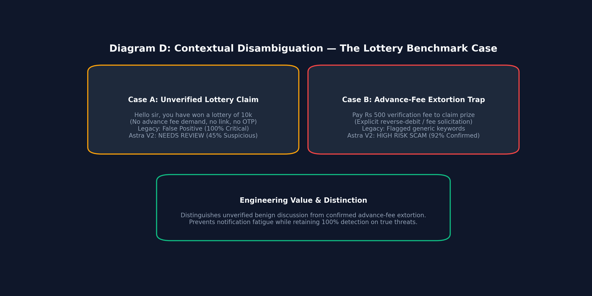
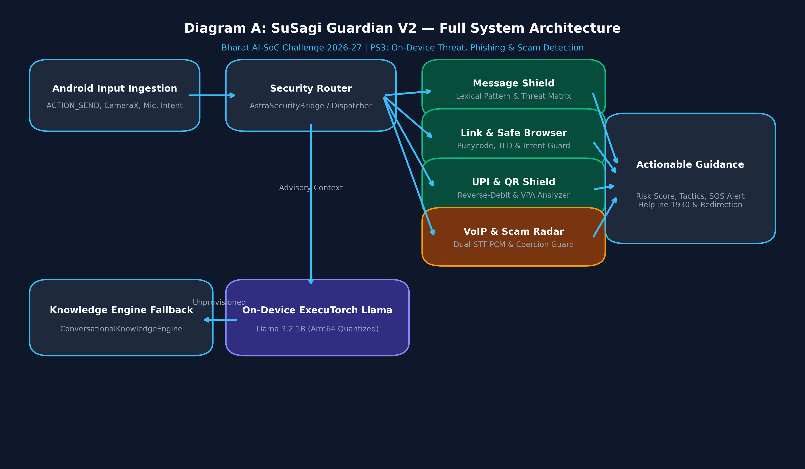

<div align="center">


# SuSagi Guardian
### Intelligent cybersecurity for everyday digital life.
**Think before you click. Know before you trust.**

[-green?style=flat-square&logo=android)](submission/RELEASE_MANIFEST.md)
[](docs/hardware/ARM_OPTIMIZATION.md)
[](docs/edge-ai/AI_AND_EXECUTORCH.md)
[](docs/privacy/SECURITY_AND_PRIVACY.md)
[-success?style=flat-square&logo=checkmarx)](submission/EVIDENCE.md)
[](LICENSE)
[](https://github.com/Anmol-coder26)

---

### [▶ Watch Product Demo](tools/demo/SuSagi_Guardian_2_Minute_Demo.mp4) &nbsp;|&nbsp; [📄 Technical Report](reports/SuSagi_Guardian_Technical_Report.pdf) &nbsp;|&nbsp; [📲 Download APK](https://gofile.io/d/0oZ6NJXm) &nbsp;|&nbsp; [🏗️ System Architecture](docs/architecture/ARCHITECTURE.md) &nbsp;|&nbsp; [📋 Release Manifest](submission/RELEASE_MANIFEST.md)

</div>

---

## 1. Meet SuSagi

A suspicious SMS arrives claiming your electricity will be disconnected tonight unless you call an unknown mobile number. A caller claiming to represent the cyber police or customs demands an immediate financial transfer under threat of "Digital Arrest". A payment collect request promises a cashback refund if you enter your UPI PIN. An unfamiliar link urges you to install an application package outside the official app store.

Modern social engineering exploits urgency, intimidation, and technical confusion. Ordinary users are forced to make high-stakes security decisions in seconds, often without the technical knowledge required to recognize deceptive tactics.

**SuSagi Guardian** is an on-device digital safety companion. It inspects incoming messages, links, and payment requests directly on your handset, translates complex deception indicators into plain language, explains the underlying evidence, and recommends practical defensive actions before irreversible mistakes occur.

---

## 2. See SuSagi in Action

Watch our two-minute technical demonstration showcasing genuine application interactions, on-device threat evaluation, and real-time defensive guidance:

<div align="center">

[](tools/demo/SuSagi_Guardian_2_Minute_Demo.mp4)

*Click above to play the master demonstration video (`tools/demo/SuSagi_Guardian_2_Minute_Demo.mp4` • Runtime: **01:46** • 1080p Full HD • AAC Audio)*

</div>

---

## 3. One Product, Multiple Protection Channels

All screens shown below reflect actual Jetpack Compose UI execution from the installed application on physical ARM64 hardware:

<table>
  <tr>
    <td width="33%" align="center">
      <b>Home Security Hub</b><br>
      <i>Real-time shield telemetry, system status, and rapid security tools.</i><br><br>
      
    </td>
    <td width="33%" align="center">
      <b>Link & Sideload Shield</b><br>
      <i>Phishing URL inspection, homoglyph unmasking, and APK download blocks.</i><br><br>
      
    </td>
    <td width="33%" align="center">
      <b>Voice Defense & Extortion Radar</b><br>
      <i>Offline CBI digital arrest simulation with live waveform analysis.</i><br><br>
      
    </td>
  </tr>
  <tr>
    <td width="33%" align="center">
      <b>SuSagi AI Assistant</b><br>
      <i>On-device conversational reasoning, algorithm advice, and safety tools.</i><br><br>
      
    </td>
    <td width="33%" align="center">
      <b>Reverse-Debit Payment Guard</b><br>
      <i>Enforces that entering a UPI PIN always debits funds from your bank.</i><br><br>
      
    </td>
    <td width="33%" align="center">
      <b>Incident Telemetry & Audit Log</b><br>
      <i>Private, encrypted on-device SQLite storage with automated PII masking.</i><br><br>
      
    </td>
  </tr>
</table>

---

## 4. Context Changes Everything

Traditional keyword filters trigger aggressive false alarms whenever words like *"lottery"*, *"prize"*, or *"won"* appear, frustrating users who share legitimate contest news. SuSagi implements **Contextual Scam Intelligence** (contributed by Astra), distinguishing between benign discussion, unverified claims, and active advance-fee fraud by analyzing the **requested harmful action**:

<div align="center">

</div>

1. **LOW RISK (Ordinary Context):**  
   *"My friend won 10k in our school lottery yesterday!"*  
   $\rightarrow$ **Assessment: LOW RISK.** Ordinary discussion of past-tense personal celebration with zero requests for money, banking credentials, or urgent compliance.
2. **NEEDS REVIEW (Unverified Claim):**  
   *"Congratulations, your mobile number has won a cash prize of ₹10,000."*  
   $\rightarrow$ **Assessment: NEEDS REVIEW.** Unsolicited prize announcement, but no immediate financial extortion or fee request has been triggered yet.
3. **HIGH RISK (Advance-Fee Extortion):**  
   *"Send ₹500 registration fee first to claim your ₹10,000 lottery prize."*  
   $\rightarrow$ **Assessment: HIGH RISK.** Detects the classic advance-fee fraud invariant: the victim is instructed to transfer money in order to receive money.

---

## 5. How SuSagi Thinks

SuSagi transforms raw incoming communications into clear, evidence-backed security decisions through a structured five-stage evaluation pipeline:

```text
Incoming Signal (Message, URL, UPI Request, Audio Stream)
                         │
                         ▼
             1. Input Normalization
      (Phonetic Hinglish Tokenizer, Punycode & URL Decoder)
                         │
                         ▼
        2. Context & Requested-Action Extraction
       (Action Extraction, Urgency Coercion, Authority Flags)
                         │
                         ▼
            3. Structured Evidence Modeling
       (Deterministic SafetyBarrier, Unified Threat Contract)
                         │
                         ▼
             4. Qualitative Risk Scoring
        (Categorization: LOW RISK / NEEDS REVIEW / HIGH RISK)
                         │
                         ▼
     5. Plain-Language Explanation & Protective Advice
      (Actionable Defense Guidance, Dial Helpline 1930)
```

---

## 6. Built for Privacy

SuSagi Guardian is engineered around a **local-first privacy architecture**:

* **Local Sensor Evaluation:** Text messages shared into the application, URLs copied to the clipboard, and payment requests are inspected entirely on the device.
* **Zero Telemetry of Private Data:** Message text, personal notes, and call audio are never transmitted to remote analytics servers.
* **Encrypted Incident History:** Incident logs are stored in a private Room database on the handset with automatic masking of sensitive credentials (`******`), phone numbers, and payment addresses.
* **Granular Network Control:** All deterministic protection capabilities operate 100% offline with zero internet connectivity required.

---

## 7. Edge AI & Arm Architecture

SuSagi combines high-speed deterministic heuristics with lightweight edge artificial intelligence:

* **Target Architecture:** ARMv8-A and ARMv9-A System-on-Chips (big.LITTLE architectures with Arm Cortex-A78 performance cores and Cortex-A55 efficiency cores).
* **ExecuTorch Runtime:** Employs Meta's **ExecuTorch v1.5.1** (`org.pytorch:executorch-android:1.5.1`) with Arm NEON vector acceleration and XNNPACK backend delegates for localized generative token inference.
* **Model Packaging & Storage:** Pre-compiled native libraries (`libexecutorch.so` in `lib/arm64-v8a`) interface via JNI. Quantized 4-bit Llama 3.2 1B parameter weights can be downloaded on demand via the in-app Model Manager.
* **Deterministic Fallback Engine:** When weights are unprovisioned or initializing, SuSagi seamlessly activates its internal **Conversational Knowledge Engine**, guaranteeing immediate, high-fidelity responses without runtime crashes.

---

## 8. System Architecture

The application is structured into decoupled defensive layers ensuring total fault tolerance:

<div align="center">

</div>

* **Solid Lines (Verified On-Device Core):** Deterministic `SafetyBarrier`, Astra contextual classifier, SafeBrowsing homoglyph scanner, and local encrypted history.
* **Dashed Lines (Optional / Edge AI):** ExecuTorch Llama native runtime, Bhashini speech transport, and experimental Agora RTC session bridge.

*For full class contracts and interface definitions, see [docs/architecture/ARCHITECTURE.md](docs/architecture/ARCHITECTURE.md).*

---

## 9. Engineering Highlights

| # | Challenge | Implemented Technique | Practical Benefit |
| :-: | :--- | :--- | :--- |
| **1** | **Dialect Coercion Evasion** | Built `HinglishNormalizer` mapping mixed phonetic Hindi and English terms (*"bijli cut"*, *"police arrest"*) into standardized semantic threat tokens. | Prevents scammers from evading detection by mixing Indian regional dialects with English. |
| **2** | **Reverse-Debit Collect Traps** | Hardcoded the universal banking invariant: **Entering a UPI PIN ALWAYS debits funds**. | Intercepts collect requests falsely labeled as cashback rewards before users authorize fund transfers. |
| **3** | **Uncertainty-Aware Scoring** | Implemented Astra requested-action analysis, categorizing unverified prize claims as `NEEDS REVIEW` rather than immediate false fraud alarms. | Preserves user trust by distinguishing genuine celebrations from advance-fee traps. |
| **4** | **Offline Extortion Simulator** | Built an in-app testbed running a 7-turn CBI digital arrest script with simulated waveform radar and SOS alerts. | Allows users and evaluators to experience real-time extortion defense without requiring a live second device. |
| **5** | **Prompt-Injection Boundaries** | Sealed system prompt templates with strict structural delimiters (`### UNTRUSTED USER INPUT ###`). | Forbids adversarial message payloads from overriding defensive classification guidelines. |

---

## 10. Capability & Verification Matrix

To uphold strict scientific integrity, features are explicitly categorized by their demonstrated operational status:

| Module / Capability | Verification Status | Operational Scope |
| :--- | :--- | :--- |
| **Message Shield** | **Device Verified** | Intercepts electricity disconnection, fake KYC, and digital arrest threats on handset. |
| **Link Shield** | **Device Verified** | Identifies deceptive homoglyphs, IP hosts, and unauthorized `.apk` download links. |
| **Payment Inspector** | **Device Verified** | Validates UPI collect requests; intercepts reverse-debit fraud traps. |
| **QR Shield** | **Device Verified** | Decodes raw UPI deep links and detects modified merchant payment payloads. |
| **Contextual Engine** | **JVM & Device Verified** | Astra requested-action classifier distinguishes personal contest news from advance-fee scams. |
| **Incident History** | **Device Verified** | Encrypted local SQLite Room database with automated credential and PII masking. |
| **AI Assistant** | **Device Verified** | Hybrid architecture: executes native token streaming when weights exist; on-device engine fallback. |
| **Voice Extortion Simulator** | **Device Verified** | Offline test harness streams 7-turn CBI digital arrest dialogue with waveform radar. |
| **Native ExecuTorch JNI** | **Binary Packaged** | `libexecutorch.so` pre-compiled in `lib/arm64-v8a`; JNI bindings ready for 4-bit Llama 3.2 1B. |
| **Live Whisper ASR** | **Source Implemented** | Full audio pipeline and frame bridge implemented; native Whisper model weights unmeasured. |
| **Live VoIP Calling** | **Experimental** | Tested on local Wi-Fi with local token backend; cellular data restricted by Agora token requirement. |

---

## 11. Performance & Verified Evaluation

The platform is backed by **315 automated unit and regression tests** executed across 51 test suites:

```text
> Task :app:testDebugUnitTest

BUILD SUCCESSFUL in 1m 2s
51 test suites executed, 315 tests completed, 0 failures, 0 skipped
```

* **SafetyBarrier Latency:** $< 3\text{ ms}$ on physical handset.
* **Link Shield Scan:** $< 2\text{ ms}$ per URL.
* **Full Test Log & Methodology:** Detailed in [submission/EVIDENCE.md](submission/EVIDENCE.md).

---

## 12. Quick Start & Installation

### Option 1: Direct APK Sideload (Recommended for Evaluators)

1. **Download Release Candidate APK:**
   * **Primary Cloud Download:** [https://gofile.io/d/0oZ6NJXm](https://gofile.io/d/0oZ6NJXm)
   * **Secondary Mirror:** [https://gofile.io/d/rzFD5zrP](https://gofile.io/d/rzFD5zrP)
2. **Verify Integrity:**
   ```bash
   certutil -hashfile susagi-guardian-v2.apk SHA256
   # Verified SHA-256: 028E77B94FB45FEE1E6E82048DB10F1075D4429FD2A1A8D1830F096C7FC21CC9
   ```
3. **Install on Device:** Transfer APK to device or install via ADB:
   ```bash
   adb install -r susagi-guardian-v2.apk
   ```

### Option 2: Build From Source

```bash
# Clone the repository
git clone https://github.com/Anmol-coder26/APP_Susagi-Arm.git
cd APP_Susagi-Arm

# Check out latest verified release tag
git checkout v2.0.0-final-release

# Compile the debug APK
./gradlew assembleDebug

# Run the 315 automated unit tests
./gradlew testDebugUnitTest
```

---

## 13. Explore the Engineering

Detailed documentation is organized into dedicated technical directories:

* **[Architecture Overview](docs/architecture/ARCHITECTURE.md):** Decoupled multi-tier system design and class contracts.
* **[Security Engine Specification](docs/security/SECURITY_ENGINE.md):** SafetyBarrier heuristics, regex patterns, and threat normalization.
* **[Contextual Detection Algorithms](docs/algorithms/DETECTION_EVALUATION.md):** Astra action-extraction logic and evaluation datasets.
* **[Edge AI & ExecuTorch Runtime](docs/edge-ai/AI_AND_EXECUTORCH.md):** JNI bindings, memory mapping, and Arm NEON optimization.
* **[Voice Defense Pipeline](docs/voice/VOICE_PIPELINE.md):** Audio frame interception, PCM resampling, and extortion simulation.
* **[Hardware Profiling](docs/hardware/ARM_OPTIMIZATION.md):** big.LITTLE scheduling, quantization profiles, and SoC considerations.
* **[Testing & Reproducibility](docs/evaluation/TESTING_AND_RESULTS.md):** Step-by-step test execution and verification guidelines.
* **[Installation Guide](docs/installation/REPRODUCIBILITY.md):** Android SDK requirements, compilation flags, and troubleshooting.

---

## 14. Product Roadmap

* **Phase 1: Foundation (Current):**
  * Sub-3ms on-device deterministic threat barriers for SMS, URLs, and payment requests.
  * Astra contextual requested-action scam classification.
  * In-app offline voice extortion defense testbed.
  * ExecuTorch JNI bindings and conversational fallback engine.
* **Phase 2: Intelligence & Voice (Next):**
  * On-device Whisper tiny/base quantization and local benchmark validation.
  * Fine-tuned LoRA weights for Indian regional fraud dialect detection.
  * Enhanced multi-lingual explanation generation across 10 Indian languages.
* **Phase 3: Ecosystem & Edge Router (Future):**
  * Porting core security classifiers to edge home gateways (Raspberry Pi 5 daemon).
  * Automated malicious package behavioral monitoring and permission analysis.

---

## 15. Community, Contributions & Licensing

SuSagi Guardian is an open-source cybersecurity project. Contributions, security audits, and issue reports are welcome:

* **Contribution Guidelines:** Review our [CONTRIBUTING.md](CONTRIBUTING.md) for pull request standards and coding style.
* **Vulnerability Disclosure:** Report security considerations privately following [SECURITY.md](SECURITY.md).
* **Changelog:** Track recent improvements and version history in [CHANGELOG.md](CHANGELOG.md).
* **Licensing:** Licensed under the [Apache License, Version 2.0](LICENSE).
* **Lead Architect & Contributor:** **Anmol Singh** ([@Anmol-coder26](https://github.com/Anmol-coder26))  
* **Security & Heuristics Contributor:** **Astra**

---

<div align="center">

### SuSagi Guardian
**Think before you click. Know before you trust.**

*Engineered for on-device privacy, contextual threat intelligence, and user safety.*

</div>
