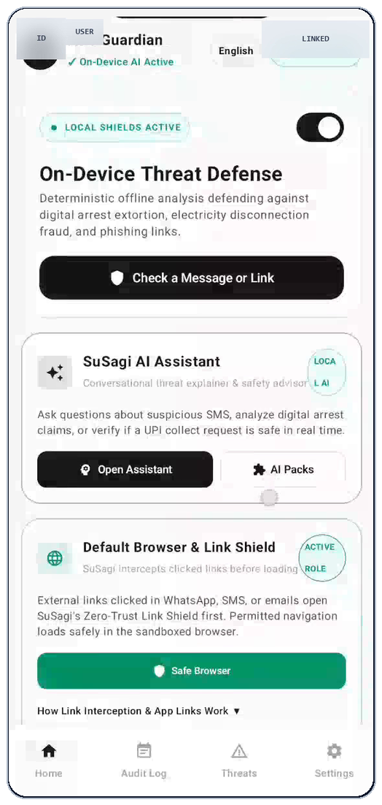
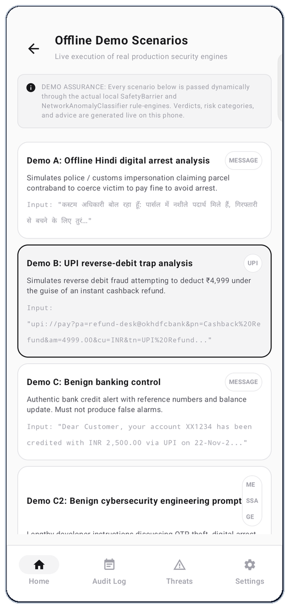
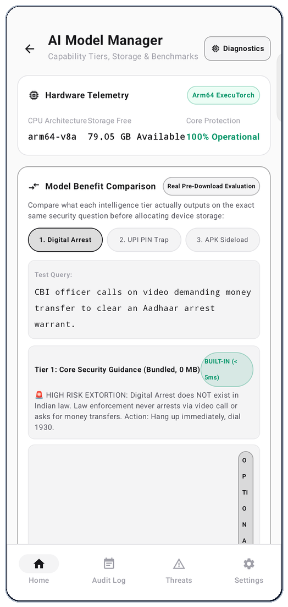
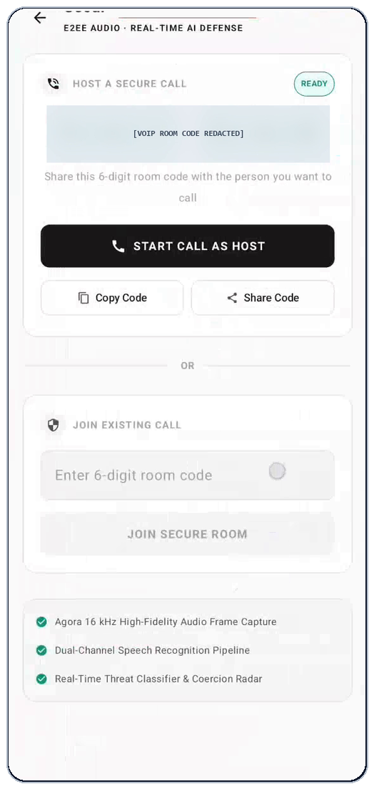
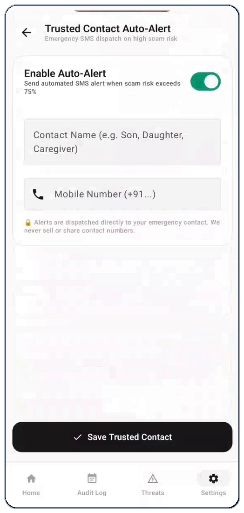
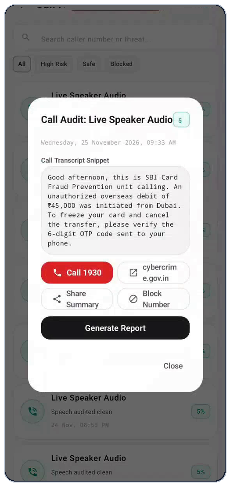
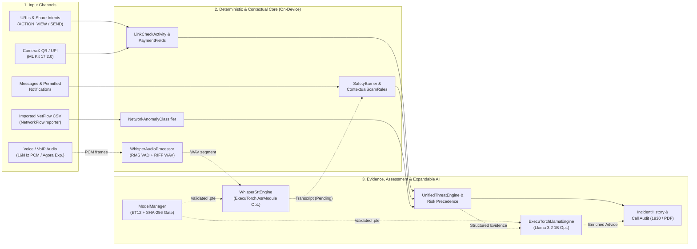
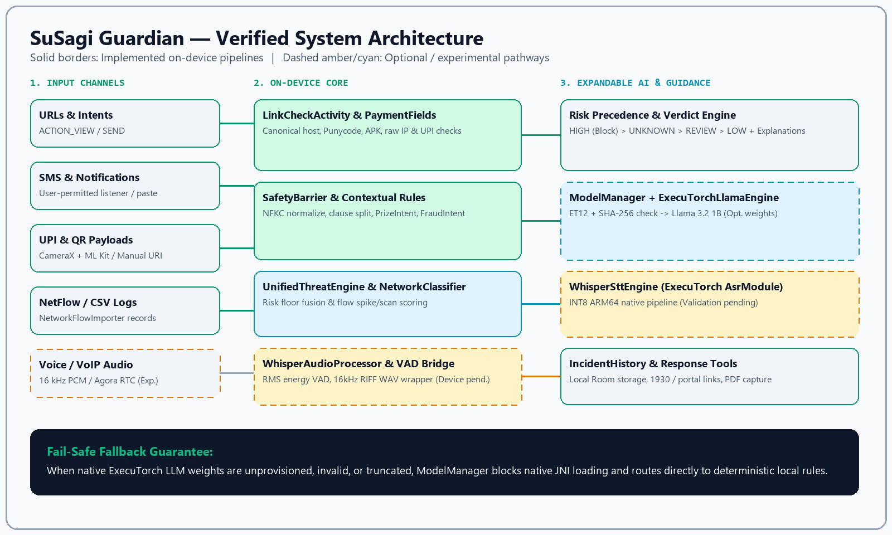

<div align="center">


# SuSagi Guardian

**Think before you click. Know before you trust.**

*A context-aware Android cybersecurity assistant with an expandable edge AI architecture.*

<br>

[-059669?style=flat-square&logo=android&logoColor=white)](docs/INSTALLATION.md)
[](docs/ARCHITECTURE.md)
[](docs/MODEL_PROVISIONING.md)
[-059669?style=flat-square)](docs/TESTING.md)
[](LICENSE)

<br>


<br>

[Product Demo](#product-demonstration) ·
[App Gallery](#application-gallery) ·
[Feature Matrix](#feature-overview) ·
[Contextual Engine](#contextual-security-intelligence) ·
[Architecture](#system-architecture) ·
[Edge AI](#on-device-ai-architecture) ·
[Install](#installation-and-setup) ·
[Limitations](#current-limitations)

</div>

---

## What is SuSagi Guardian?

SuSagi Guardian (`com.susagi.guardian2`) is an Android cybersecurity assistant engineered over four months to help users inspect suspicious links, payment requests, QR codes, text notifications, network logs, and audio interactions before acting.

Instead of relying solely on heavy cloud classifiers or generic chatbots, SuSagi separates **deterministic offline security screening** from an **expandable local neural stack** powered by PyTorch ExecuTorch on `arm64-v8a` devices. Every alert aims to surface observable evidence, requested-action context, and clear remediation guidance—including direct escalation paths to India's Cybercrime Helpline (`1930`) and `https://cybercrime.gov.in`.

---

## The Problem

Everyday digital users face fast-moving social-engineering threats designed to override calm judgment:

- **Digital arrest impersonation:** Attackers posing as police, customs, or central agency officers threaten immediate warrants or custody to coerce video calls and "safe account" transfers.
- **Fraudulent UPI & reverse-debit QR payloads:** Payment strings (`upi://pay`) disguised as refunds or lottery winnings exploit the misconception that scanning a QR code or entering a UPI PIN can receive money.
- **Phishing URLs & APK dropper traps:** Obfuscated links—using raw IP hosts, Punycode lookalikes, nested redirects, or disguised `.apk` payloads—circulate across chat apps and SMS.
- **OTP & credential disclosure scripts:** Urgent KYC-expiry or electricity-disconnection threats combine social pressure with regional phrasing and code-mixed Hindi/English.
- **Anomalous network activity:** Suspicious host communications, port reconnaissance, and periodic command-and-control (C2) beaconing remain invisible to standard mobile users.

Conventional spam filters often over-flag benign conversations mentioning keywords like *"lottery"* or *"police"*, while single-purpose browsers lack context across calls, QR codes, and payment URIs. No security system eliminates fraud entirely, so SuSagi pairs structural signal extraction with clear risk explanations to support human decisions.

---

## Our Approach

```text
Suspicious Interaction
   -> Contextual Examination (clause normalization, requested action, canonical URL/UPI parse)
   -> Evidence Extraction (structured Signal flags & host/payment fields)
   -> Risk Assessment (precedence scoring & uncertainty disclosure)
   -> Protective Guidance (user confirmation gate, Call Audit & 1930 portal access)
```

1. **Deterministic core first:** URL canonicalization, `upi://pay` parsing, `.apk` detection, and contextual rule engines (`SafetyBarrier`, `ContextualScamRules`, `PrizeIntent`) operate cleanly offline with zero mandatory cloud dependency.
2. **Requested-action distinction:** Rather than blacklisting isolated nouns, contextual analyzers evaluate *who is speaking* and *what action is demanded* (e.g., whether an advance fee, OTP disclosure, or PIN entry accompanies a claim).
3. **Expandable generative tier:** Provisioned `ExecuTorch` weights (`Llama 3.2 1B` and `Whisper`) enrich explanations and voice tools locally without blocking core protection when unprovisioned or unsupported by device memory.

---

## Product Demonstration

Watch **`INSIDE SUSAGI — From Threat to Protection.`** (`01:50.99`, `1080p`), assembled strictly from genuine handset interactions with personal identifiers, tracking parameters, VoIP room digits, and browser session history persistently redacted:

<div align="center">

[](SUSAGI_FINAL_SUBMISSION/SUSAGI_GUARDIAN_FINAL_SUBMISSION.mp4)

[Play Demo MP4 (`01:51 · 1080p`)](SUSAGI_FINAL_SUBMISSION/SUSAGI_GUARDIAN_FINAL_SUBMISSION.mp4) ·
[Synchronized Subtitles (`.srt`)](SUSAGI_FINAL_SUBMISSION/Subtitles.srt) ·
[Narration Script](SUSAGI_FINAL_SUBMISSION/Narration_Script.txt)

</div>

---

## Application Gallery

Every screen below is extracted from genuine application sessions on physical Android hardware, with private identifiers, notification bars, share sheets, URL tracking tokens, and room codes permanently redacted.

<div align="center">
<table>
  <tr>
    <td width="33%" align="center" valign="top">
      <br>
      <b>Home Dashboard</b><br>
      <sub>Central workspace launching Link Shield, AI Assistant, and active defense modules.</sub>
    </td>
    <td width="33%" align="center" valign="top">
      <br>
      <b>Message Shield</b><br>
      <sub>Manual SMS/chat inspection screen with explicit Android notification sandboxing notice.</sub>
    </td>
    <td width="33%" align="center" valign="top">
      <br>
      <b>Contextual Scam Assessment</b><br>
      <sub>Controlled offline test scenarios exercising digital arrest, UPI, and benign controls.</sub>
    </td>
  </tr>
  <tr>
    <td width="33%" align="center" valign="top">
      <br>
      <b>Link Shield</b><br>
      <sub>Canonical host parsing and local static inspection prior to browser navigation.</sub>
    </td>
    <td width="33%" align="center" valign="top">
      <br>
      <b>UPI Protection</b><br>
      <sub>Parses `upi://pay` VPA/amount fields and warns against reverse-debit refund claims.</sub>
    </td>
    <td width="33%" align="center" valign="top">
      <br>
      <b>QR Inspection</b><br>
      <sub>CameraX + ML Kit scanner decoding QR payloads locally before opening external targets.</sub>
    </td>
  </tr>
  <tr>
    <td width="33%" align="center" valign="top">
      <br>
      <b>Network Intelligence</b><br>
      <sub>Offline inspection of imported CSV NetFlow records flagging periodic C2 beaconing.</sub>
    </td>
    <td width="33%" align="center" valign="top">
      <br>
      <b>Voice Shield (Speaker Guard)</b><br>
      <sub>Real-time risk vector view running a controlled staged SBI script (scored 5/100 here).</sub>
    </td>
    <td width="33%" align="center" valign="top">
      <br>
      <b>SuSagi AI Assistant</b><br>
      <sub>Domain safety shortcuts alongside an offline liveness turn when Llama is active.</sub>
    </td>
  </tr>
  <tr>
    <td width="33%" align="center" valign="top">
      <br>
      <b>AI Model Manager</b><br>
      <sub>Manages local Llama 3.2 1B SpinQuant and Whisper INT8 packages with safety fallback notes.</sub>
    </td>
    <td width="33%" align="center" valign="top">
      <br>
      <b>Intelligence Mode Tiers</b><br>
      <sub>Arm64 telemetry and side-by-side comparison across rule-only vs downloadable AI tiers.</sub>
    </td>
    <td width="33%" align="center" valign="top">
      <br>
      <b>Secure VoIP (Experimental)</b><br>
      <sub>Agora room interface scaffolding with session code redacted; peer call requires backend.</sub>
    </td>
  </tr>
  <tr>
    <td width="33%" align="center" valign="top">
      <br>
      <b>Trusted Person Config</b><br>
      <sub>Local emergency contact setup UI (autonomous remote SMS delivery verification pending).</sub>
    </td>
    <td width="33%" align="center" valign="top">
      <br>
      <b>Threat History</b><br>
      <sub>Cross-channel log spanning web destinations, unverified UPI links, and direct IP APK flags.</sub>
    </td>
    <td width="33%" align="center" valign="top">
      <br>
      <b>Incident Remediation</b><br>
      <sub>Call Audit transcript snippet with Helpline 1930, `cybercrime.gov.in`, and PDF capture.</sub>
    </td>
  </tr>
  <tr>
    <td colspan="3" align="center" valign="top">
      <br>
      <b>Privacy Boundaries & Language Preferences</b><br>
      <sub>10 Indian regional script selectors alongside explicit Android notification sandboxing disclosures.</sub>
    </td>
  </tr>
</table>
</div>

---

## Feature Overview

Status classification follows strict engineering evidence categories:
**`Device verified`** (observed working end-to-end on physical handset) · **`Implemented — verification pending`** (source + unit tests or UI built; physical device validation incomplete) · **`Experimental`** (active prototype / external service dependency) · **`Known issue`** · **`Planned`**.

| Feature | Purpose | Implementation Component | Development Status | Physical-Device Verification |
| :--- | :--- | :--- | :--- | :--- |
| **Link Shield (`ACTION_VIEW` / `SEND` & Manual)** | Inspects tapped/shared URLs for raw IPs, Punycode, brand spoofing, shorteners, redirects & `.apk` payloads | `LinkCheckActivity.kt`, `SafetyBarrier.kt`, `LinkSafetyBarrierScreen.kt` | Implemented | **Device verified** (static heuristic inspection & consent handoff) |
| **Camera QR & Barcode Shield** | Scans QR codes locally and inspects decoded `http`/`https`/`upi` destinations before opening | `QrScannerActivity.kt`, CameraX `1.3.4`, ML Kit `17.2.0` | Implemented | **Device verified** |
| **UPI Payment Protection** | Parses `upi://pay` fields (`pa`, `pn`, `am`, `cu`) and flags reverse-debit cashback/refund requests | `PaymentFields.kt`, `SafetyBarrier.kt` | Implemented | **Device verified** (offline demo & URI barrier) |
| **Contextual Scam Engine** | Disambiguates benign mentions vs advance-fee, extortion, credential, and KYC fraud | `SafetyBarrier.kt`, `ContextualScamRules.kt`, `PrizeIntent.java`, `FraudIntent.kt` | Implemented | **Device verified** (JVM verified + Offline Demo Panel; live speaker calibration ongoing) |
| **Message Shield & Notification Scan** | Analyzes pasted text or user-permitted notifications (never accesses encrypted chat DBs) | `MessageScanScreen.kt`, `NotificationScannerService.kt`, `HinglishNormalizer` | Implemented | **Implemented — verification pending** (UI & JVM verified; live listener soak test pending) |
| **Threat History & Call Audit** | Stores logged flags locally and prepares PDF/text summaries with Helpline `1930` / portal shortcuts | `IncidentHistoryStore.kt`, `CallHistoryEntity.kt`, `Screens.kt`, `EvidenceCaptureActivity.kt` | Implemented | **Device verified** (Call Audit log, PDF modal & portal handoff shown) |
| **Network Flow Intelligence** | Detects admin ports, SYN spikes, port scans, and periodic C2 beaconing in flow batches | `NetworkAnomalyClassifier.kt`, `NetworkFlowImporter.kt`, `NetworkShieldScreen.kt` | Implemented (CSV import) | **Implemented — verification pending** (CSV demo verified; live OS packet monitoring blocked without VPN/gateway -> **Planned**) |
| **AI Model Manager & Tier Comparison** | Validates `ET12` headers, sizes, and SHA-256 digests; manages local/SAF `.pte` discovery | `ModelManager.kt`, `ModelManifest.kt`, `ModelManagerScreen.kt` | Implemented | **Device verified** (package listing, tier comparison & `READY` detection shown) |
| **On-Device Llama Assistant** | Provides conversational safety guidance via ExecuTorch `LlmModule` with output sanitization | `ExecuTorchLlamaEngine.kt`, `ConversationManager.kt`, `SuSagiAssistantScreen.kt` | Implemented (**Known issue** tuning) | **Implemented — verification pending** (short liveness greeting shown; full reasoning & prompt-echo stability require benchmark validation) |
| **Whisper Offline Speech AI** | Captures 16 kHz PCM into RIFF WAV turns and runs ExecuTorch `AsrModule` transcription | `WhisperSttEngine.kt`, `WhisperAudioProcessor.kt`, `VoiceClipScannerScreen.kt` | Implemented | **Implemented — verification pending** (models listed Ready on storage; live physical microphone ASR transcription unverified) |
| **Speaker Guard (Live Call Radar)** | Monitors speakerphone utterances via acoustic radar and staged simulation scenarios | `Screens.kt`, `CallProtectionService.kt`, `LiveRiskEngine.kt` | **Experimental / Known issue** | **Experimental** (UI active; staged SBI scenario scored `LOW 5/100` in Build D74 recording; calibration pending) |
| **Secure Two-Way VoIP Calling** | Room-code voice calling paired with real-time Agora RTC/RTM transcript channels | `AgoraEngine.kt`, `VoipCallViewModel.kt`, `RoomCodeActivity.kt` | **Experimental** | **Experimental** (room UI renders; live two-device connection & backend token auth unverified here) |
| **Trusted Person Emergency Config** | Stores emergency contact config and sends HTTP JSON payload to `/alerts/trusted-contact` | `TrustedContactSettingsScreen.kt`, `TrustedContactManager.kt`, `TrustedContactAlertSender.kt` | **Implemented (Config)** / Alert **Experimental** | **Implemented — verification pending** (config form works locally; remote alert delivery not verified end-to-end) |
| **Home Edge Gateway (Phase 2)** | Inline `eBPF` telemetry & DNS sinkhole across household devices | Architecture specification only | **Planned** | **Planned** |

---

## Contextual Security Intelligence

Instead of reacting indiscriminately to keywords such as *"lottery"* or *"police"*, `SafetyBarrier.kt`, `PrizeIntent.java`, `CredentialIntent.kt`, `FraudIntent.kt`, and `ContextualScamRules.kt` inspect **context and requested action**:

| Input | Relevant Context | Engine Assessment Basis *(from source rules)* |
| :--- | :--- | :--- |
| *My school organized a lottery.* | Benign discussion | `PrizeIntent` detects informational `CONTEXT` (`school (conducted\|held)`) -> `Finding.NONE` (**Low risk**). |
| *You have won ₹10,000.* | Unverified prize claim | `PrizeIntent` matches directed prize/amount claim without fee demand -> `Signal.PRIZE_CLAIM` (`Risk.REVIEW`). |
| *Pay ₹500 to receive your prize.* | Advance-payment demand | `PrizeIntent` / `ContextualScamRules` links payout claim + upfront transfer demand -> `Signal.ADVANCE_FEE` (`Risk.HIGH`). |
| *Share your OTP to claim the prize.* | Credential disclosure request | `CredentialIntent` & `SafetyBarrier` match credential + disclosure verb (`share OTP`) -> `Signal.OTP` (`Risk.HIGH`). |

### Implemented Detection Techniques (`app/src/main/java/com/susagi/safety/`)

1. **Unicode Normalization & Obfuscation Stripping:** `Normalizer.Form.NFKC`, root lowercasing, apostrophe normalization, and removal of invisible zero-width characters (`\u200b`, `\ufeff`, `\u2060`, `\u00ad`) before regex matching.
2. **Educational & Quoted Example Suppression:** Strips attributed advisory examples (e.g., `"scammers say: ..."`) and explicit negative advisories (`"do not share OTP"`, `"मत भेजें"`) so cyber-awareness warnings are not conflated with live coercion.
3. **Clause Splitting & Multi-Clause Lookahead:** Splits text along sentence boundaries (`[.!?;।\n]+`) and evaluates pairs of `(clause, nextClause)` so multi-sentence traps (claim in clause 1, transfer/OTP demand in clause 2) remain catchable.
4. **URL Canonicalization & Redirect Budget:** Validates IPv4/IPv6 brackets, `IDN.toASCII` labels, Punycode mismatch checks, Latin/Cyrillic lookalike character checks (`0x370..0x52f` + skeleton replacements), deceptive bank brand tokens, `.apk` suffixes, and query redirect recursion capped at `depth <= 3` / `budget = 8`.

*(Illustrative unit verdicts are validated in JVM suites including `PrizeContextTest`, `ContextPairsTest`, and `SafetyBarrierTest`; generalized real-world accuracy figures are not claimed without large labeled physical field trials.)*

---

## Security Assessment Methodology

Every inspected URL, message, or QR payload evaluates to an explicit `Assessment` (`SafetyBarrier.kt`) or fused `InferenceResult` (`UnifiedThreatEngine.kt`):

- **Risk Precedence:** `Risk.HIGH` > `Risk.UNKNOWN` > `Risk.REVIEW` > `Risk.LOW`.
- **Mapped Protective Action:**
  - `Risk.HIGH` -> `Action.RECOMMEND_BLOCK` (score floor `>= 85` in `UnifiedThreatEngine.withBarrier`)
  - `Risk.UNKNOWN` -> `Action.DO_NOT_OPEN`
  - `Risk.REVIEW` -> `Action.ASK_CONFIRMATION` (score floor `>= 40`)
  - `Risk.LOW` -> `Action.OFFER_OPEN`
- **Provenance & Uncertainty:** Outputs record source attribution (`OFFLINE_RULES`, `LOCAL_RULES`, `LLAMA_EXECUTORCH`, `HEURISTIC_FALLBACK`) and preserve the explicit local boundary note: *"Offline inspection cannot establish ownership, reputation or the destination after navigation."*

---

## System Architecture

> **Legend:** **Solid lines** represent implemented local pipelines; **dashed lines** denote optional neural inference or experimental integrations.



<details>
<summary><b>View static high-resolution architecture diagram</b></summary>

<br>



</details>

---

## On-Device AI Architecture

### 1. Llama Integration (`com.susagi.edgeai`)
- **Models & Format:** `ModelManifest` pins Software Mansion's `Llama 3.2 1B Instruct (SpinQuant Int4 XNNPACK)` (`llama_3_2_1b_xnnpack_spinquant.pte`, `~1.08 GB`, HuggingFace `tokenizer.json`, ~9.45 MB) and Community `Llama 3.2 1B (FP16)` (`llama3_2-1B.pte`, `~2.47 GB`, `tokenizer.model`, ~2.08 MB).
- **Prompt Construction:** `ThreatPromptBuilder` and `ConversationManager` assemble Llama 3.2 Instruct chat markers (`<|begin_of_text|>`, `<|start_header_id|>system|user|assistant<|end_header_id|>`, `<|eot_id|>`) with bounded turn history (`maxTurnsToKeep = 10`, `maxCharsPerTurn = 2048`).
- **Native Execution & Guardrails:** `ExecuTorchLlamaEngine` initializes `org.pytorch.executorch.extension.llm.LlmModule` lazily (`seqLen = 2048`, `echo = false`), validates JSON/text outputs, strips special tokens via `sanitizeLlamaOutput`, and detects echoed inputs via `isPromptEcho` before falling back safely to deterministic local guidance (`ConversationalKnowledgeEngine`).
- **Scope Honesty:** SuSagi uses upstream ExecuTorch/community quantized packages directly—no custom Llama weight fine-tuning is claimed, and open-ended conversational accuracy/latency await comprehensive physical-device profiling.

### 2. Whisper Integration (`com.susagi.stt.whisper`)
- **Audio Capture & PCM Framing:** `WhisperAudioProcessor` accepts 16 kHz 16-bit mono PCM chunks, runs RMS energy VAD (`vadThresholdRms = 120.0`, `minTurnBytes = 25,600` [800 ms], `maxSegmentBytes = 160,000` [5.0 s], `silenceHangoverFrames = 5`), and wraps frames into 44-byte RIFF WAV headers.
- **Native ASR & Decoding:** `WhisperSttEngine` loads `org.pytorch.executorch.extension.asr.AsrModule` with `model`, `whisper_preprocessor.pte` (~78 KB), and `tokenizer.json`. `WhisperDecoder` strips `<|...|>` and timestamp tokens and suppresses repetitive decoding loops (`suppressRepetitions`). Model readiness checks exist in UI; live physical handset speech accuracy and latency remain pending validation.

### 3. ExecuTorch & ARM64 Runtime
- **Pinned Dependency (`app/build.gradle.kts`):** `org.pytorch:executorch-android:1.5.1`.
- **Target Hardware Architecture:** Built for `arm64-v8a` Android devices using XNNPACK CPU/NEON quantized kernels packaged inside the ExecuTorch runtime (`libexecutorch.so`). Custom NPU delegate acceleration beyond ExecuTorch XNNPACK defaults is not claimed.

---

## Model Lifecycle & Provisioning


SuSagi decouples core installation from optional `> 100 MB` model binaries to avoid bloating APKs or committing weights to Git:

- **Pre-Flight Binary Validation (`ModelManager.kt`):** Checks `ET12` FlatBuffer magic identifier (`offset 4` with validated `rootTableOffset` or `offset 0`), verifies file sizes against pinned manifest sizes (`±50 MB`), and supports full SHA-256 verification across internal storage, public `Downloads` paths, or manual Storage Access Framework selection.
- **Zero-Crash Guarantee:** Invalid or incomplete downloads transition `ModelManager.ModelState` to `MODEL_INVALID` or `MODEL_INCOMPATIBLE`—never handing corrupt buffers to JNI—so deterministic rule shields continue uninterrupted.

For complete manifest SHA-256 digests and storage paths, see [docs/MODEL_PROVISIONING.md](docs/MODEL_PROVISIONING.md).

---

## Security & Privacy Boundaries

- **Local Processing Scope:** `SafetyBarrier`, `LinkCheckActivity.evaluateLinkSafety`, `ContextualScamRules`, `PaymentFields`, QR parsing, `NetworkAnomalyClassifier`, local Room incident history, and validated `ExecuTorch` weights run without remote inference calls.
- **Optional External Services:** When configured and explicitly used, optional integrations exist for Agora RTC/RTM calling (`AgoraEngine`), companion backend relay (`BACKEND_URL`), Gemini role evaluation (`GeminiRoleClient`), Bhashini speech/translation, Firebase Auth/FCM, and Ably alerts.
- **Notification & Storage Boundaries:** `NotificationScannerService` inspects notifications only after explicit user approval in Android System Settings and never opens third-party messaging databases. `LinkCheckActivity` states clearly that offline heuristics cannot verify DNS ownership or post-redirect targets.
- **Credential Hygiene:** `app/build.gradle.kts` strips `GEMINI_API_KEY`, `BHASHINI_ULCA_API_KEY`, `BHASHINI_INFERENCE_API_KEY`, and `ABLY_API_KEY` from release `BuildConfig` fields. Previously committed development Agora IDs or LAN defaults in older history must be rotated and treated as compromised; never redistribute uncleaned legacy APKs.

Full permission breakdown and security guidance: [docs/SECURITY.md](docs/SECURITY.md) · [SECURITY.md](SECURITY.md).

---

## Technology Stack

Verified directly against [build.gradle.kts](build.gradle.kts) and [app/build.gradle.kts](app/build.gradle.kts):

| Category | Technology & Exact Version |
| :--- | :--- |
| **Platform & SDK** | Android (`compileSdk = 35`, `targetSdk = 35`, `minSdk = 26`), Java `17` |
| **Language** | Kotlin `2.0.21` (with selective Java components such as `PrizeIntent.java`) |
| **UI Framework** | Jetpack Compose BOM `2024.09.03`, Material 3, Activity Compose `1.9.2` |
| **Edge AI Runtime** | Meta PyTorch ExecuTorch [`org.pytorch:executorch-android:1.5.1`](https://pytorch.org/executorch/) (`LlmModule`, `AsrModule`) |
| **Language Models** | Meta Llama 3.2 1B Instruct (`SpinQuant INT4 XNNPACK` & `FP16` `.pte` via `ModelManifest`) |
| **Speech Models** | OpenAI Whisper Tiny & Small (`INT8 XNNPACK` `.pte` + preprocessor via `ModelManifest`) |
| **Vision & QR** | AndroidX CameraX `1.3.4` + ML Kit Barcode Scanning `17.2.0` |
| **Persistence & Security** | AndroidX Room `2.6.1` (KSP), `androidx.security:security-crypto:1.1.0-alpha06` |
| **Networking** | OkHttp `4.12.0`, Socket.IO Client `2.1.0` |
| **Optional RTC / Cloud** | Agora Voice SDK `4.4.1`, Agora RTM `2.2.1`, Firebase BOM `33.7.0`, Ably `1.2.0` |
| **Build & Testing** | Android Gradle Plugin `8.5.2`, KSP `2.0.21-1.0.28`, JUnit `4.13.2`, `org.json:20231013` |

---

## Installation & Setup

### Prerequisites
- JDK 17, Android SDK (`API 26–35`), Android Studio (or CLI Gradle wrapper `./gradlew`), and an `arm64-v8a` Android handset for hardware/model testing.

### Build & Install from Source

```bash
git clone https://github.com/Anmol-coder26/APP_Susagi-Arm.git
cd APP_Susagi-Arm
cp local.properties.template local.properties
# Edit local.properties and set sdk.dir=<path-to-your-Android-SDK>

# 1. Verify offline unit tests (318 tests / 51 suites)
./gradlew testDebugUnitTest --offline

# 2. Build & install debug APK onto connected handset
./gradlew assembleDebug
adb install -r app/build/outputs/apk/debug/app-debug.apk
```

- **No Cloud Keys Required for Core Shields:** Leave `GEMINI_API_KEY`, `AGORA_APP_ID`, `ABLY_API_KEY`, and `BHASHINI_*` empty in `local.properties` when testing local link, message, QR, audit log, and ExecuTorch weight loading workflows.
- **Prebuilt Binary Notice:** Public prebuilt APK release links from prior competition iterations are withheld pending key-rotation cleanup; build cleanly from source or follow [docs/INSTALLATION.md](docs/INSTALLATION.md).

---

## Testing & Benchmarks

SuSagi strictly separates host JVM verification from physical ARM64 Android validation:

- **Automated JVM Unit Tests (`app/build/test-results/testDebugUnitTest/`):** **318 tests across 51 test suites passing** (`0` failures, `0` errors, `0` skipped; cumulative suite execution time **12.37s**). Covers `SafetyBarrier`, `PrizeContextTest`, `PaymentMutationTest`, `LinkCheckSecurityTest`, `UnifiedThreatEngineTest`, `ModelManagerTest`, `NetworkAnomalyClassifierTest`, `AudioFramePipelineTest`, and `WhisperModuleTest`.
- **Android Instrumented Harnesses (`app/src/androidTest/`):** Includes `LlamaNativeInferenceDeviceTest`, `WhisperNativeInferenceDeviceTest`, `EndToEndScamDetectionDeviceTest`, and `AgoraVoipDeviceTest` requiring physical `arm64-v8a` targets and staged `.pte` assets.
- **Benchmark Discipline:** No generalized tokens/sec, Whisper Word Error Rate, RAM ceilings, or real-world call accuracy claims are asserted where continuous device-farm benchmarking has not been logged. In recorded Build D74 walk-through runs, the scripted *Speaker Guard SBI KYC* scenario returned `LOW (5/100)`, reflecting active tuning of live call thresholds.

Full test breakdown: [docs/TESTING.md](docs/TESTING.md).

---

## Project Structure

<details>
<summary><b>Explore Repository Layout</b></summary>

```text
APP_Susagi-Arm/
├── app/
│   ├── build.gradle.kts              # SDK 26-35, ExecuTorch 1.5.1, CameraX, Room & release hardening
│   └── src/
│       ├── main/java/
│       │   ├── com/guardian/app/     # UI screens, LinkCheckActivity, QrScannerActivity, CallAudit, AgoraEngine
│       │   └── com/susagi/
│       │       ├── safety/           # SafetyBarrier, ContextualScamRules, PrizeIntent, PaymentFields
│       │       ├── intelligence/     # UnifiedThreatEngine, AstraSecurityBridge, classifiers
│       │       ├── edgeai/           # ModelManifest, ModelManager, ExecuTorchLlamaEngine, ConversationManager
│       │       ├── stt/whisper/      # WhisperSttEngine, WhisperAudioProcessor, WhisperDecoder
│       │       ├── network/          # NetworkAnomalyClassifier, NetworkFlowImporter
│       │       ├── ui/               # Assistant, ModelManager, OfflineDemo, VoiceClip & Network UIs
│       │       └── call/             # Experimental VoIP UI & ViewModel
│       ├── test/                     # 51 JVM unit & regression test suites (318 tests)
│       └── androidTest/              # Physical-device ExecuTorch & VoIP instrumented tests
├── assets/
│   ├── branding/                     # SVG logo, hero banner & demo thumbnail
│   ├── diagrams/                     # Verified architecture & lifecycle visuals
│   └── screenshots/gallery/          # 16 privacy-redacted authentic product screens
├── docs/                             # ARCHITECTURE, SECURITY, MODEL_PROVISIONING, INSTALLATION, TESTING, LIMITATIONS, ROADMAP
├── server/                           # Optional Node.js relay for Agora tokens, contacts & alerts (.env.example)
├── submission/ & SUSAGI_FINAL_SUBMISSION/  # Competition-specific archive, reports & final film
├── CONTRIBUTING.md
├── LICENSE                           # Apache License 2.0
├── NOTICE.md
└── SECURITY.md
```

</details>

---

## Current Limitations

- **Generative LLM Tuning & Hardware Staging:** `Llama 3.2 1B` requires manual `.pte` staging (~1.08 GB); output sanitizer and prompt-echo defenses are active, while general multi-turn reasoning quality remains under hardware validation.
- **Whisper Native Audio Validation Pending:** Native `AsrModule` wiring and audio preprocessors exist, but live phone microphone speech accuracy has not been benchmarked end-to-end.
- **Experimental Agora VoIP & Speaker Guard Calibration:** Live two-device VoIP calls depend on external backend tokens; stock Android (API 29+) restricts direct PSTN uplink/downlink audio capture (`VOICE_CALL`), and live Speaker Guard thresholding remains under calibration (`LOW 5/100` observed in SBI demo).
- **Trusted Contact Dispatch Dependency:** Local recipient settings save reliably, whereas remote dispatch routes via `BACKEND_URL` (`/alerts/trusted-contact` / `/alerts/family`) rather than verified carrier SMS alerts.
- **Network Shield Scope:** Inspects imported NetFlow CSV logs locally; non-root Android apps cannot sniff system traffic without enabling a `VpnService` (`tun0`) intercept or home gateway node.

Detailed disclosure: [docs/LIMITATIONS.md](docs/LIMITATIONS.md).

---

## Development Roadmap

- **Calibrate Live Voice & Speaker Guard Scoring** against realistic Indian scam transcripts paired with end-to-end physical `WhisperSttEngine` benchmarks.
- **Harden `ExecuTorchLlamaEngine` Output & Tool Grounding** across quantized `SpinQuant INT4` device runs.
- **Complete Signed Clean Releases & Credential Rotation** after purging all legacy development keys and hardcoded LAN defaults.
- **Optional Local `VpnService` Telemetry & Companion Home Edge Gateway:** See [docs/ROADMAP.md](docs/ROADMAP.md) and [Phase 2 Architecture](docs/hardware/PHASE2_RASPBERRY_PI_ROADMAP.md).

---

## Contributors

- **Anmol Singh** ([@Anmol-coder26](https://github.com/Anmol-coder26)) — Project Creator & Lead Engineer
- **Tanya Singh** — Co-Contributor

---

## License & Acknowledgements

Licensed under the [Apache License 2.0](LICENSE).  
Incorporates open-source components including PyTorch ExecuTorch (BSD-3-Clause), Meta Llama 3.2 model format tooling, OpenAI Whisper / Arm XNNPACK packages, Android Jetpack / CameraX / ML Kit (Apache-2.0), Agora SDK, and Bhashini interfaces — see [NOTICE.md](NOTICE.md).

---

## Hackathon Submission Archive

Competition-specific deliverables prepared separately from core product documentation are preserved in:
- [Official Final Submission Bundle](FINAL_SUBMISSION/05_Submission/Submission_Information.txt) · [Feature Verification Matrix](FINAL_SUBMISSION/03_Repository/Feature_Verification_Matrix.md) · [PS3 Traceability](FINAL_SUBMISSION/04_Evidence/PS3_Requirement_Traceability.md)
- [Final Technical Report (PDF)](SUSAGI_FINAL_SUBMISSION/SuSagi_Guardian_Final_Technical_Report.pdf) · [Editable Report (DOCX)](SUSAGI_FINAL_SUBMISSION/SuSagi_Guardian_Final_Technical_Report.docx) · [Final Submission Demo Film (`01:51`)](SUSAGI_FINAL_SUBMISSION/SUSAGI_GUARDIAN_FINAL_SUBMISSION.mp4)
- [Legacy Submission Links](submission/SUBMISSION_LINKS.md) · [Test Evidence Summary](submission/EVIDENCE.md) · [Release Manifest](submission/RELEASE_MANIFEST.md)
