<div align="center">


# SuSagi Guardian

**Think before you click. Know before you trust.**

*A context-aware Android cybersecurity assistant with an expandable ARM64 edge AI architecture.*

<p>
  <a href="docs/INSTALLATION.md"></a>
  <a href="docs/ARCHITECTURE.md"></a>
  <a href="docs/MODEL_PROVISIONING.md"></a>
  <a href="docs/TESTING.md"></a>
  <a href="LICENSE"></a>
</p>

[Product Film](#product-demonstration) &nbsp;·&nbsp;
[App Spotlight](#application-spotlight) &nbsp;·&nbsp;
[Feature Matrix](#feature-overview) &nbsp;·&nbsp;
[Contextual Engine](#contextual-security-intelligence) &nbsp;·&nbsp;
[Architecture](#system-architecture) &nbsp;·&nbsp;
[Edge AI](#on-device-ai-architecture) &nbsp;·&nbsp;
[Quick Start](#installation--setup) &nbsp;·&nbsp;
[Limitations](#current-limitations)

<br>

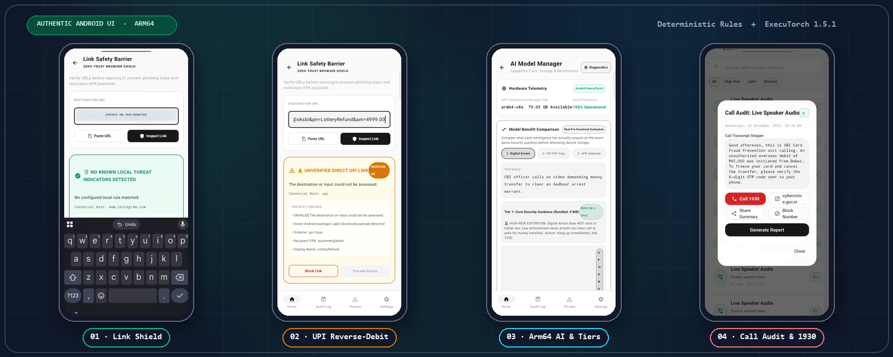

</div>

---

## Why SuSagi Guardian?

Mobile scams in India rarely use a single lure—they pair urgent psychological scripts (*digital arrest* threats, fake KYC shutoffs, reverse-debit QR cashback traps, sideloaded `.apk` droppers) with code-mixed Hinglish and disguised URLs. Keyword blacklists over-trigger on harmless bank notices (*"never share your OTP"*), while cloud-only AI analyzers leak private conversations and stall offline.

SuSagi Guardian (`com.susagi.guardian2`) resolves this trade-off with a **two-tier architecture** across **four months of engineering**:

<table>
  <tr>
    <td width="33%" valign="top">
      <h4>1. Deterministic Shields First</h4>
      <sub>Offline contextual regex, Unicode NFKC normalization, canonical host inspection, CameraX QR parsing, and <code>upi://pay</code> validation execute locally in milliseconds with zero network reliance.</sub>
    </td>
    <td width="33%" valign="top">
      <h4>2. Requested-Action Precision</h4>
      <sub>Instead of flagging isolated keywords like <i>"lottery"</i> or <i>"police"</i>, cross-clause rules distinguish harmless discussions and warnings from live fee, OTP, or authority coercion.</sub>
    </td>
    <td width="33%" valign="top">
      <h4>3. Expandable ARM64 Edge AI</h4>
      <sub>Optional <code>ExecuTorch 1.5.1</code> packages (<code>Llama 3.2 1B SpinQuant</code> &amp; <code>Whisper INT8</code>) validate via pre-flight <code>ET12</code> header &amp; SHA-256 checks without gating core shields.</sub>
    </td>
  </tr>
</table>

> [!IMPORTANT]
> **Engineering Honesty First:** Deterministic shields, `318/318` automated JVM tests, and core UI verification (`Link`, `QR`, `UPI`, `ModelManager`, `Call Audit`, `CSV NetFlow`) are verified on physical handset Build `D74`. Experimental two-device Agora VoIP calling, live Speaker Guard calibration (`5/100` observed in SBI simulation), and physical Whisper live WER benchmarks remain transparently disclosed under [Current Limitations](#current-limitations).

---

## Product Demonstration

<div align="center">

<a href="SUSAGI_FINAL_SUBMISSION/SUSAGI_GUARDIAN_FINAL_SUBMISSION.mp4">
  
</a>

<br><br>

[**Watch Film (`01:51 · 1080p MP4`)**](SUSAGI_FINAL_SUBMISSION/SUSAGI_GUARDIAN_FINAL_SUBMISSION.mp4) &nbsp;&nbsp;|&nbsp;&nbsp;
[**Synchronized Subtitles (`.srt`)**](SUSAGI_FINAL_SUBMISSION/Subtitles.srt) &nbsp;&nbsp;|&nbsp;&nbsp;
[**Narration Script**](SUSAGI_FINAL_SUBMISSION/Narration_Script.txt) &nbsp;&nbsp;|&nbsp;&nbsp;
[**Shot-Timing Manifest**](FINAL_SUBMISSION/01_Video/Shot_Timing_Manifest.md)

<sub>Assembled strictly from genuine Vivo iQOO Z7 Pro 5G (Build <code>D74</code>) footage with personal identifiers, share sheets, URL tokens, and VoIP room codes permanently redacted.</sub>

</div>

---

## Application Spotlight

Six core surfaces spanning prevention, contextual disambiguation, local AI management, and 1930 escalation:

<div align="center">
<table>
  <tr>
    <td width="33%" align="center" valign="top">
      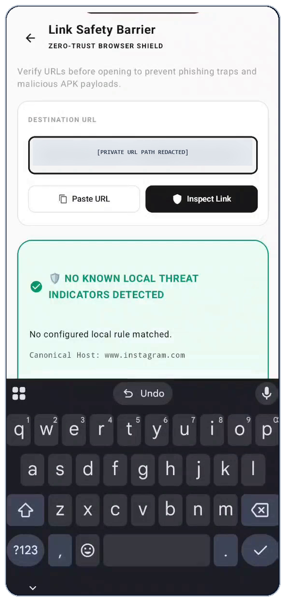<br>
      <b>Link Safety Barrier</b><br>
      <sub>Intercepts <code>ACTION_VIEW</code>/<code>SEND</code> intents, canonicalizes tracking URLs, and gates external browsers.</sub>
    </td>
    <td width="33%" align="center" valign="top">
      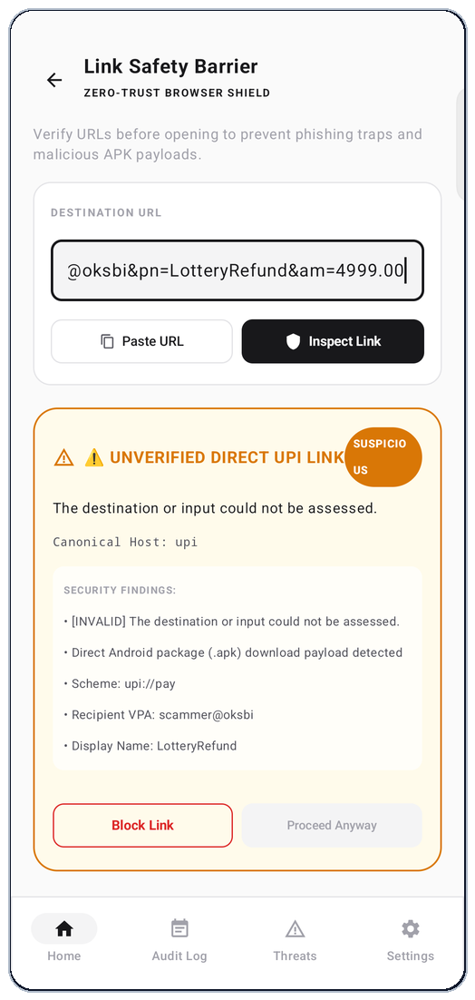<br>
      <b>UPI Reverse-Debit Guard</b><br>
      <sub>Parses <code>upi://pay</code> fields (<code>pa</code>, <code>am</code>, <code>cu</code>) and exposes fake refund/cashback traps.</sub>
    </td>
    <td width="33%" align="center" valign="top">
      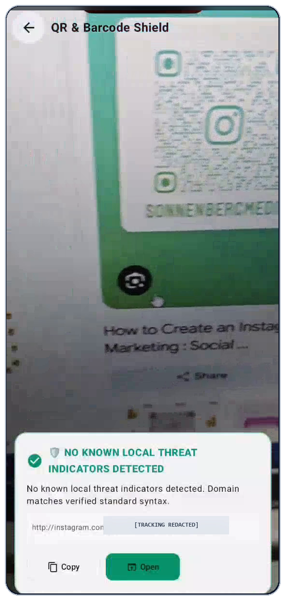<br>
      <b>CameraX QR Vision</b><br>
      <sub>Decodes barcodes locally via Google ML Kit before opening external URLs or payment targets.</sub>
    </td>
  </tr>
  <tr>
    <td width="33%" align="center" valign="top">
      <br>
      <b>Contextual Scam Engine</b><br>
      <sub>Runs offline Hindi digital-arrest, UPI reverse-debit, and benign banking control scenarios.</sub>
    </td>
    <td width="33%" align="center" valign="top">
      <br>
      <b>Arm64 Telemetry &amp; AI Tiers</b><br>
      <sub>Displays <code>arm64-v8a</code> telemetry alongside rule-only vs optional <code>ExecuTorch</code> comparisons.</sub>
    </td>
    <td width="33%" align="center" valign="top">
      <br>
      <b>Call Audit &amp; 1930 Escalation</b><br>
      <sub>Bundles transcript logs with one-tap <code>Call 1930</code>, <code>cybercrime.gov.in</code>, and PDF report actions.</sub>
    </td>
  </tr>
</table>
</div>

<details>
<summary><b>Browse All 16 Verified Application Screens</b> &nbsp;<sub>(Home, Message Shield, NetFlow C2, Speaker Guard, AI Assistant, Tiers, VoIP, Trusted Contact, Threat Log &amp; 10-Script Settings)</sub></summary>

<br>

<div align="center">
<table>
  <tr>
    <td width="20%" align="center" valign="top">
      <br>
      <b>Home</b><br><sub>Defense cards &amp; nav</sub>
    </td>
    <td width="20%" align="center" valign="top">
      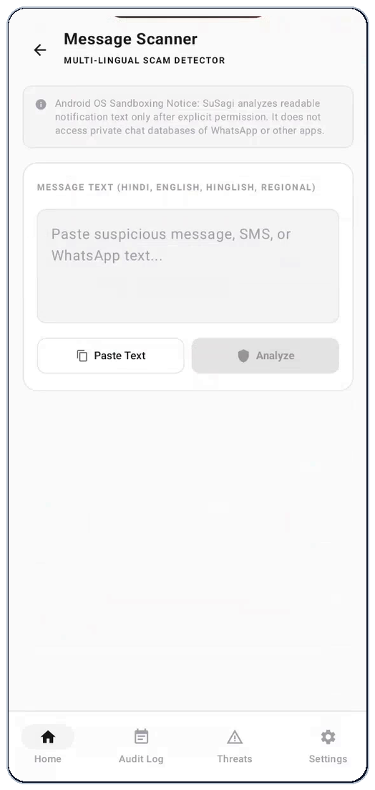<br>
      <b>Message Shield</b><br><sub>Opt-in listener notice</sub>
    </td>
    <td width="20%" align="center" valign="top">
      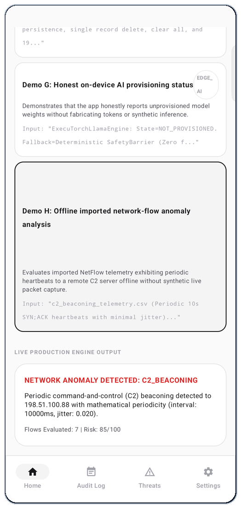<br>
      <b>NetFlow CSV</b><br><sub><code>85/100 C2_BEACONING</code></sub>
    </td>
    <td width="20%" align="center" valign="top">
      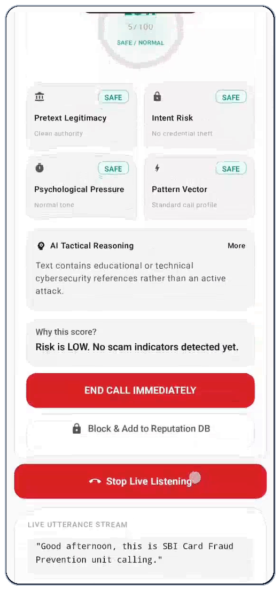<br>
      <b>Speaker Guard</b><br><sub>SBI sim (<code>5/100</code> status)</sub>
    </td>
    <td width="20%" align="center" valign="top">
      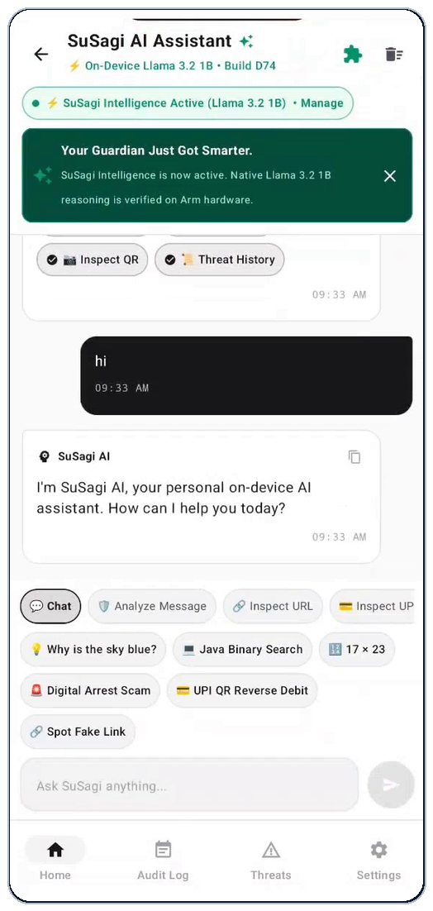<br>
      <b>AI Assistant</b><br><sub>Offline <code>hi</code> liveness turn</sub>
    </td>
  </tr>
  <tr>
    <td width="20%" align="center" valign="top">
      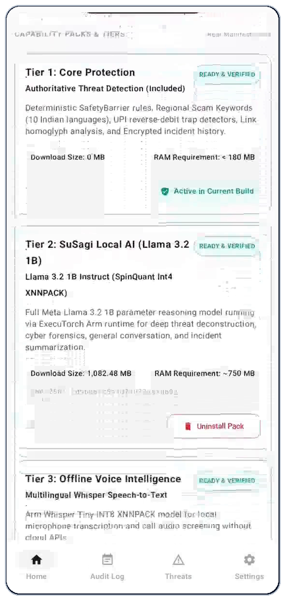<br>
      <b>Model Manager</b><br><sub><code>ET12</code> &amp; SHA-256 packages</sub>
    </td>
    <td width="20%" align="center" valign="top">
      <br>
      <b>VoIP (Exp.)</b><br><sub>Redacted room UI</sub>
    </td>
    <td width="20%" align="center" valign="top">
      <br>
      <b>Trusted Contact</b><br><sub>Local alert config UI</sub>
    </td>
    <td width="20%" align="center" valign="top">
      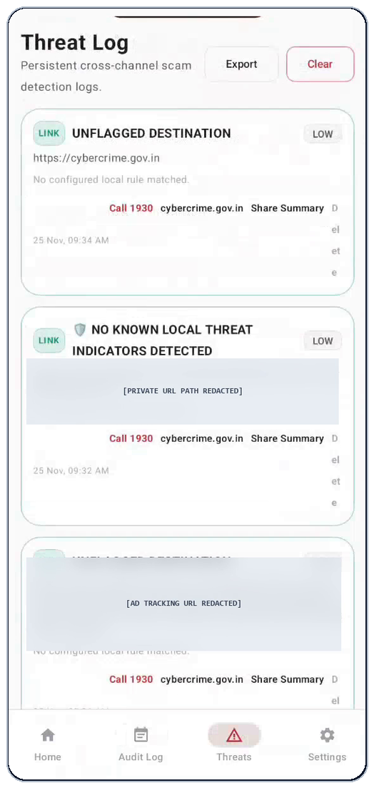<br>
      <b>Threat History</b><br><sub>UPI &amp; raw-IP APK logs</sub>
    </td>
    <td width="20%" align="center" valign="top">
      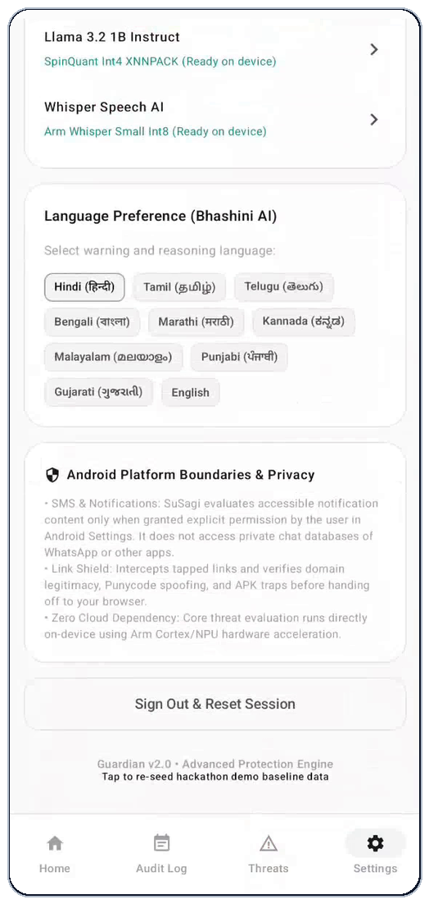<br>
      <b>Privacy &amp; Scripts</b><br><sub>10 Indian UI scripts</sub>
    </td>
  </tr>
</table>
</div>

</details>

---

## Feature Overview

Status categories align strictly across README, Video, and Technical Report:
**`Device verified`** · **`Implemented — verification pending`** · **`Experimental`** · **`Known issue`** · **`Planned`**.  
Full 7-column Single Source of Truth: [Feature_Verification_Matrix.md](FINAL_SUBMISSION/03_Repository/Feature_Verification_Matrix.md).

| Feature | Purpose | Implementation Component | Development Status | Physical-Device Verification |
| :--- | :--- | :--- | :--- | :--- |
| **Link Shield (`ACTION_VIEW`/`SEND`)** | Unmasks raw IPs, Punycode, brand spoofs, shorteners &amp; `.apk` links before browsing | `LinkCheckActivity.kt`, `SafetyBarrier.kt`, `LinkSafetyBarrierScreen.kt` | Implemented | **Device verified** (static barrier &amp; consent gate) |
| **Camera QR &amp; Barcode Shield** | Scans QR codes locally and inspects decoded destinations prior to launch | `QrScannerActivity.kt`, CameraX `1.3.4`, ML Kit `17.2.0` | Implemented | **Device verified** |
| **UPI Payment Protection** | Validates `upi://pay` (`pa`, `pn`, `am`, `cu`) and flags reverse-debit traps | `PaymentFields.kt`, `SafetyBarrier.kt` | Implemented | **Device verified** (offline demo &amp; URI barrier) |
| **Contextual Scam Engine** | Disambiguates benign prize/police mentions vs fee, OTP &amp; extortion fraud | `SafetyBarrier.kt`, `ContextualScamRules.kt`, `PrizeIntent.java`, `FraudIntent.kt` | Implemented | **Device verified** (JVM verified + Offline Demo Panel) |
| **Message Shield &amp; Notification Scan** | Inspects pasted chat text or opt-in Android notifications (zero DB access) | `MessageScanScreen.kt`, `NotificationScannerService.kt`, `HinglishNormalizer` | Implemented | **Implemented — verification pending** (listener soak pending) |
| **Threat History &amp; Call Audit** | Persists multi-vector logs cleanly with Helpline `1930` / portal &amp; PDF tools | `IncidentHistoryStore.kt`, `CallHistoryEntity.kt`, `EvidenceCaptureActivity.kt` | Implemented | **Device verified** |
| **Network Flow Intelligence** | Detects admin ports, SYN bursts, scans &amp; low-jitter C2 beaconing in CSVs | `NetworkAnomalyClassifier.kt`, `NetworkFlowImporter.kt`, `NetworkShieldScreen.kt` | Implemented (CSV) | **Device verified** (CSV Demo H; live `tun0` **Planned**) |
| **AI Model Manager &amp; Tiers** | Enforces `ET12` magic, size bounds &amp; SHA-256 digests across `.pte` packages | `ModelManager.kt`, `ModelManifest.kt`, `ModelManagerScreen.kt` | Implemented | **Device verified** |
| **On-Device Llama Assistant** | Conversational guidance via ExecuTorch `LlmModule` with echo sanitization | `ExecuTorchLlamaEngine.kt`, `ConversationManager.kt`, `SuSagiAssistantScreen.kt` | Implemented | **Implemented — verification pending** (greeting shown; perf open) |
| **Whisper Offline Speech AI** | 16 kHz PCM RMS-VAD framing + ExecuTorch `AsrModule` transcription | `WhisperSttEngine.kt`, `WhisperAudioProcessor.kt`, `VoiceClipScannerScreen.kt` | Implemented | **Implemented — verification pending** (live WER unmeasured) |
| **Speaker Guard (Live Radar)** | Monitors speakerphone utterances and controlled SBI test dialogues | `Screens.kt`, `CallProtectionService.kt`, `LiveRiskEngine.kt` | **Known issue** | **Known issue** (staged SBI scenario scored `5/100` in Build D74) |
| **Secure Two-Way VoIP Calling** | Room-code calling backed by Agora RTC/RTM transcript channels | `AgoraEngine.kt`, `VoipCallViewModel.kt`, `RoomCodeActivity.kt` | **Experimental** | **Experimental** (room UI renders; backend token auth needed) |
| **Trusted Person Alert Config** | Saves emergency contact config locally &amp; dispatches JSON to `/alerts` | `TrustedContactSettingsScreen.kt`, `TrustedContactManager.kt` | **Implemented** | **Implemented — verification pending** (remote SMS unverified) |
| **Home Edge Gateway (Phase 2)** | Inline `eBPF` telemetry &amp; DNS sinkhole on ARM Linux gateways | [Phase 2 Architecture](docs/hardware/PHASE2_RASPBERRY_PI_ROADMAP.md) | **Planned** | **Planned** |

---

## Contextual Security Intelligence

Instead of reacting blindly to words such as *"lottery"* or *"police"*, `SafetyBarrier.kt`, `PrizeIntent.java`, `CredentialIntent.kt`, `FraudIntent.kt`, and `ContextualScamRules.kt` normalize obfuscated Unicode and inspect **clause-pair requested actions**:

| Input Scenario | Contextual Class | Deterministic Rule Outcome |
| :--- | :--- | :--- |
| *"My school organized a lottery."* | Benign past event | `PrizeIntent` matches informational `CONTEXT` -> `LOW RISK` (`OFFER_OPEN`). |
| *"You have won ₹10,000."* | Unsolicited claim | Directed amount without fee/OTP act -> `REVIEW` (`ASK_CONFIRMATION`). |
| *"Pay ₹500 to receive your prize."* | Advance-fee extortion | Claim paired with upfront payment clause -> `HIGH` (`RECOMMEND_BLOCK`). |
| *"Share your OTP to claim the prize."* | Credential trap | `CredentialIntent` matches OTP + disclosure verb -> `HIGH` (`RECOMMEND_BLOCK`). |

<details>
<summary><b>How the 4-Stage Contextual Pipeline Works</b> &nbsp;<sub>(NFKC cleaning, warning suppression, clause pairs, risk floor invariants)</sub></summary>

1. **Unicode Normalization & Obfuscation Stripping:** Applies `Normalizer.Form.NFKC`, root lowercasing, curly apostrophe folding, and stripping of zero-width characters (`\u200b`, `\ufeff`, `\u2060`, `\u00ad`) up to `MAX = 32,768` chars (`Signal.LIMIT`).
2. **Educational & Warning Exclusion:** Removes quoted advisory examples (`reportedExample`) and negative warnings (`"never share OTP"`, `"मत भेजें"`) before scanning.
3. **Clause Lookahead & Link Unwrapping:** Evaluates `(clause[i], clause[i+1])` transitions; unwraps nested redirect parameters up to `depth <= 3` / `budget <= 8`; checks IPv4/IPv6 brackets, `IDN.toASCII` labels, Punycode/Cyrillic homoglyphs (`0x370..0x52f`), and direct `.apk` installers.
4. **Immutable Precedence (`UnifiedThreatEngine.withBarrier`):** Enforces `HIGH` (score floor `>= 85`) > `UNKNOWN` > `REVIEW` (`>= 40`) > `LOW` so probabilistic LLM text can never downgrade high-risk deterministic evidence.

</details>

---

## System Architecture

> **Legend:** **Solid emerald/navy blocks** run deterministically on-device; **dashed cyan/amber blocks** indicate optional native AI or experimental modules.

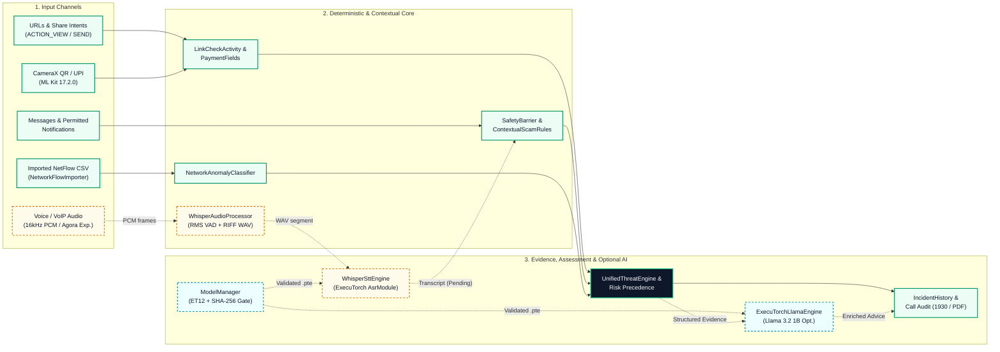

<details>
<summary><b>View static high-resolution architecture diagram</b></summary>

<br>


</details>

---

## On-Device AI Architecture

<details open>
<summary><b>ExecuTorch 1.5.1 Stack — Llama 3.2 1B, Whisper INT8 &amp; Model Lifecycle</b></summary>

1. **Llama Integration (`com.susagi.edgeai`):**
   - `ModelManifest.kt` pins Software Mansion's `Llama 3.2 1B Instruct (SpinQuant INT4 XNNPACK)` (`1,082,483,584` B, ~`1.08 GB` + `tokenizer.json` ~`9.45 MB`) and Community `Llama 3.2 1B FP16` (`2,471,922,052` B, ~`2.47 GB` + `tokenizer.model` ~`2.08 MB`)—no custom weight fine-tuning is claimed.
   - `ExecuTorchLlamaEngine.kt` lazily loads `LlmModule(..., 0.7f)`, resets KV-cache context via `resetContext()`, calls `generate(prompt, 2048, cb, false)` (`echo = false`), and applies `sanitizeLlamaOutput()` / `isPromptEcho()` before falling back cleanly to `ConversationalKnowledgeEngine`.
2. **Whisper Speech Pipeline (`com.susagi.stt.whisper`):**
   - `WhisperAudioProcessor.kt` consumes 16 kHz mono PCM16 (`32,000` B/s), applies RMS VAD (`vadThresholdRms = 120.0`, `5`-frame hangover, `0.8 s–5.0 s` turn slicing), and wraps segments in 44-byte RIFF WAV headers for `AsrModule` (`Arm Whisper Tiny INT8` ~`116.58 MB` / `Small` ~`395.05 MB`).
3. **ARM64 & Pre-Flight Model Gate (`ModelManager.kt`):**
   - Packages `org.pytorch:executorch-android:1.5.1` (`lib/arm64-v8a/libexecutorch.so`) executing on Arm CPU/NEON via **XNNPACK** kernels; custom vendor NPU/GPU delegates are not claimed.
   - Validates `ET12` FlatBuffer magic (`offset 4` / `offset 0`), `±50 MB` byte bounds, and SHA-256 digests prior to JNI initialization so truncated multi-gigabyte downloads transition cleanly to `MODEL_INVALID` without `SIGABRT`.

<p align="center">
  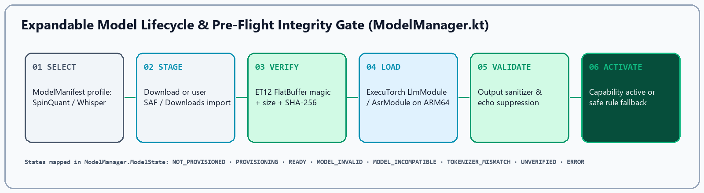
</p>

</details>

---

## Technology Stack & Security Boundaries

<table>
  <tr>
    <td width="50%" valign="top">
      <h4>Verified Build Stack (<code>app/build.gradle.kts</code>)</h4>
      <ul>
        <li><b>Android SDK:</b> <code>minSdk 26</code> – <code>targetSdk 35</code> (Android 8–15)</li>
        <li><b>Language &amp; UI:</b> Kotlin <code>2.0.21</code>, Java <code>17</code>, Compose BOM <code>2024.09.03</code></li>
        <li><b>Edge AI:</b> <code>org.pytorch:executorch-android:1.5.1</code> (<code>arm64-v8a</code>)</li>
        <li><b>Vision &amp; DB:</b> CameraX <code>1.3.4</code>, ML Kit <code>17.2.0</code>, Room <code>2.6.1</code>, <code>security-crypto</code></li>
        <li><b>Optional RTC:</b> Agora Voice <code>4.4.1</code> / RTM <code>2.2.1</code>, OkHttp <code>4.12.0</code>, Socket.IO <code>2.1.0</code>, Firebase BOM <code>33.7.0</code>, Ably <code>1.2.0</code></li>
        <li><b>Verification:</b> JUnit <code>4.13.2</code> · <b>318 / 318</b> unit tests passing across <b>51</b> suites (<code>12.37 s</code>)</li>
      </ul>
    </td>
    <td width="50%" valign="top">
      <h4>Privacy &amp; Credential Hygiene (<code>docs/SECURITY.md</code>)</h4>
      <ul>
        <li><b>Offline Core:</b> Links, UPI/QR, messages, CSV NetFlow &amp; local logs run offline without remote telemetry.</li>
        <li><b>Scoped OS Permissions:</b> <code>NotificationListenerService</code> runs only on explicit opt-in and never reads WhatsApp/messaging DBs.</li>
        <li><b>Honest Disclosures:</b> Offline screening states explicitly it cannot confirm external DNS ownership post-redirect.</li>
        <li><b>Release Hardening:</b> Release builds strip <code>GEMINI_API_KEY</code>, <code>BHASHINI_*</code> &amp; <code>ABLY_API_KEY</code>; historical Agora/LAN dev defaults are flagged for owner-side rotation prior to shared backend hosting.</li>
      </ul>
    </td>
  </tr>
</table>

---

## Installation & Setup

```bash
git clone https://github.com/Anmol-coder26/APP_Susagi-Arm.git
cd APP_Susagi-Arm
cp local.properties.template local.properties
# Edit local.properties -> set sdk.dir=<path-to-your-Android-SDK>

# 1. Verify offline deterministic & pipeline tests (318 tests / 51 suites)
./gradlew testDebugUnitTest --offline

# 2. Build & install clean debug APK onto an arm64-v8a handset
./gradlew assembleDebug
adb install -r app/build/outputs/apk/debug/app-debug.apk
```

- **No Cloud Keys Required for Core Shields:** Leave optional keys (`GEMINI_API_KEY`, `AGORA_APP_ID`, `ABLY_API_KEY`, `BHASHINI_*`) blank for offline screening and local `.pte` testing ([docs/MODEL_PROVISIONING.md](docs/MODEL_PROVISIONING.md)).
- **Prebuilt Binary Notice:** Legacy third-party APK mirrors from prior commits are retired pending key rotation; compile cleanly from source via [docs/INSTALLATION.md](docs/INSTALLATION.md).

<details>
<summary><b>Explore Repository Directory Layout &amp; Documentation Hub</b></summary>

```text
APP_Susagi-Arm/
├── app/                         # Kotlin 2.0.21 + Compose Android app (safety, intelligence, edgeai, whisper, network, call)
├── assets/
│   ├── branding/                # SVG logo, 4-phone showcase strip & film thumbnail
│   ├── diagrams/                # Source-grounded architecture & lifecycle diagrams
│   └── screenshots/gallery/     # 16 privacy-redacted authentic product screens
├── docs/                        # ARCHITECTURE, SECURITY, MODEL_PROVISIONING, INSTALLATION, TESTING, LIMITATIONS, ROADMAP
├── FINAL_SUBMISSION/            # Organized 01_Video..05_Submission package, SSOT matrix & PS3 traceability
├── server/                      # Optional Node.js Agora/alert relay (.env.example)
├── submission/ & reports/       # Final 33-page PDF/DOCX Technical Report & synced competition records
├── LICENSE & NOTICE.md          # Apache License 2.0 + third-party attributions
└── SECURITY.md                  # Vulnerability reporting & operating boundaries
```

</details>

---

## Current Limitations & Roadmap

| Area | Current Honest Boundary | Next Planned Milestone |
| :--- | :--- | :--- |
| **Llama Multi-Turn Reasoning** | Short offline `"hi"` greeting verified; Build `D74` echo guard active (`sanitizeLlamaOutput`); tok/s &amp; TTFT unmeasured | Profile quantized `SpinQuant INT4` latency &amp; audit multi-turn grounding via `LlamaNativeInferenceDeviceTest` |
| **Whisper Live Speech ASR** | 16 kHz WAV/VAD framing passes unit tests; `Tiny INT8` staged; hardware live WER/RTF unbenchmarked | Execute noisy Hindi/Hinglish handset microphone validation suite (`WhisperNativeInferenceDeviceTest`) |
| **Speaker Guard &amp; Agora VoIP** | SBI simulation returned `LOW (5/100)` in Build `D74`; two-device VoIP requires backend token server &amp; rotated Agora creds | Calibrate `LiveRiskEngine` live thresholds against `SafetyBarrier`; provision clean rotated token relay |
| **Trusted Contact Dispatch** | Local recipient UI saves cleanly; remote dispatch routes to `BACKEND_URL/alerts`; SMS delivery unverified | Implement delivery acknowledgement and opt-in offline SMS fallback testing |
| **Live Network Inspection** | Currently analyzes imported CSV NetFlow batches (`85/100 C2_BEACONING` verified in Demo H) | Build opt-in local `VpnService` (`tun0`) metadata collector &amp; [Phase 2 Home Gateway](docs/hardware/PHASE2_RASPBERRY_PI_ROADMAP.md) |

Detailed documentation: [docs/TESTING.md](docs/TESTING.md) · [docs/LIMITATIONS.md](docs/LIMITATIONS.md) · [docs/ROADMAP.md](docs/ROADMAP.md)

---

## Contributors, License & Submission Archive

- **Contributors:** **Anmol Singh** ([@Anmol-coder26](https://github.com/Anmol-coder26), Project Creator &amp; Lead Engineer) · **Tanya Singh** (Co-Contributor)
- **License:** [Apache License 2.0](LICENSE) · Third-party notices in [NOTICE.md](NOTICE.md)
- **Competition Submission Archive (Separate from Core Identity):**
  [Official Submission Bundle](FINAL_SUBMISSION/05_Submission/Submission_Information.txt) ·
  [Feature Verification Matrix](FINAL_SUBMISSION/03_Repository/Feature_Verification_Matrix.md) ·
  [PS3 Traceability](FINAL_SUBMISSION/04_Evidence/PS3_Requirement_Traceability.md) ·
  [Final Technical Report (`33p PDF`)](SUSAGI_FINAL_SUBMISSION/SuSagi_Guardian_Final_Technical_Report.pdf) ·
  [Editable Report (`DOCX`)](SUSAGI_FINAL_SUBMISSION/SuSagi_Guardian_Final_Technical_Report.docx)
