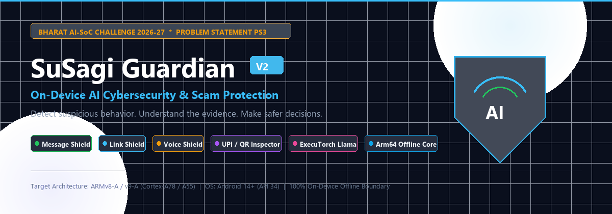
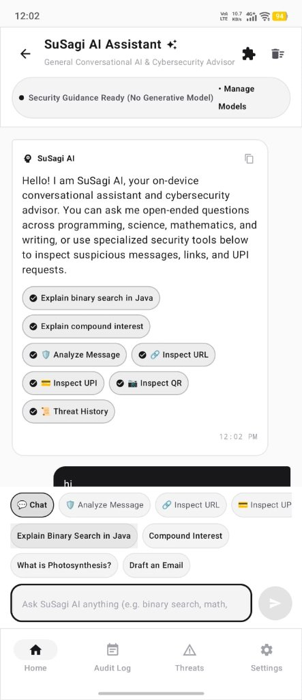

<div align="center">



# SuSagi Guardian
### Your intelligent digital safety companion.
*Context-aware cybersecurity and local AI for everyday digital threats.*

[](submission/PS3_COMPLIANCE.md)
[-green?style=flat-square&logo=android)](submission/RELEASE_MANIFEST.md)
[](docs/hardware/ARM_OPTIMIZATION.md)
[](docs/edge-ai/AI_AND_EXECUTORCH.md)
[-success?style=flat-square&logo=checkmarx)](submission/EVIDENCE.md)
[](LICENSE)
[](https://github.com/Anmol-coder26)

---

### [▶ Watch Demo](tools/demo/SuSagi_Guardian_2_Minute_Demo.mp4) &nbsp;|&nbsp; [📄 Technical Report](reports/Final_Project_Report.pdf) &nbsp;|&nbsp; [📲 Download APK](https://gofile.io/d/0oZ6NJXm) &nbsp;|&nbsp; [🏗️ Architecture](docs/architecture/ARCHITECTURE.md) &nbsp;|&nbsp; [📋 PS3 Matrix](submission/PS3_COMPLIANCE.md)

</div>

---

## 1. The Product Story

Every day, mobile users in India face deceptive communications: urgent SMS warnings threatening electricity disconnection, fake law-enforcement calls alleging "Digital Arrest", malicious APK sideload links, and fraudulent UPI collect requests masquerading as cashback rewards. Standard defensive measures often confuse users with cryptic security jargon or route sensitive private messages to remote cloud servers for analysis.

**SuSagi Guardian** acts as an on-device digital safety companion. Designed for the **Bharat AI-SoC Challenge 2026–27 (Problem Statement PS3)**, it inspects suspicious messages, links, and payment requests locally on the handset, breaks down deception tactics into plain language, and provides actionable defensive advice before users commit irreversible actions.

The platform employs a **local-first defensive architecture**: high-confidence deterministic safety barriers evaluate threats in milliseconds with zero network transmission, while native Arm-optimized AI runtimes provide contextual conversational explanations on demand.

---

## 2. Authentic Application Showcase

The interfaces below represent actual Jetpack Compose UI execution on physical ARM64 Android handsets:

<table>
  <tr>
    <td width="33%" align="center">
      <b>Home Security Hub</b><br>
      <i>Real-time shield telemetry, active status, and one-tap tools.</i><br><br>
      
    </td>
    <td width="33%" align="center">
      <b>Link & Sideload Shield</b><br>
      <i>Phishing URL inspection, homoglyph unmasking, and APK blocks.</i><br><br>
      
    </td>
    <td width="33%" align="center">
      <b>Voice Defense & Extortion Radar</b><br>
      <i>Offline CBI digital arrest simulation with waveform radar.</i><br><br>
      
    </td>
  </tr>
  <tr>
    <td width="33%" align="center">
      <b>SuSagi AI Assistant</b><br>
      <i>On-device conversational reasoning and guidance.</i><br><br>
      
    </td>
    <td width="33%" align="center">
      <b>Reverse-Debit Payment Guard</b><br>
      <i>Enforces that entering a UPI PIN always debits funds.</i><br><br>
      
    </td>
    <td width="33%" align="center">
      <b>Incident Telemetry & Audit Log</b><br>
      <i>Private, encrypted on-device SQLite storage with PII masking.</i><br><br>
      
    </td>
  </tr>
</table>

---

## 3. Core Security Innovation: Contextual Threat Intelligence

Traditional spam filters rely on static keyword matching, triggering false alarms whenever words like *"lottery"* or *"won"* appear. SuSagi implements **Contextual Scam Intelligence** (contributed by Astra), distinguishing between benign discussion, unverified claims, and active advance-fee fraud by analyzing the **requested harmful action**:

<div align="center">

</div>

1. **Benign Celebration:**  
   *"My friend won 10k in our school lottery yesterday!"*  
   $\rightarrow$ **Assessment: LOW RISK.** Context indicates past-tense personal celebration with zero requests for funds or credentials.
2. **Unverified Claim (Needs Review):**  
   *"Congratulations, your mobile number won ₹10,000."*  
   $\rightarrow$ **Assessment: NEEDS REVIEW.** Unsolicited win announcement, but no immediate financial extortion mechanism has been triggered yet.
3. **Advance-Fee Extortion (High Risk):**  
   *"Pay ₹500 processing fee first to claim your ₹10,000 cash prize."*  
   $\rightarrow$ **Assessment: HIGH RISK.** Detects the classic advance-fee fraud invariant: the victim is instructed to transfer money in order to receive money.

---

## 4. System Architecture

SuSagi Guardian is organized into decoupled defensive layers ensuring that critical threat detection remains operational even if generative model weights are loading or offline:

<div align="center">

</div>

* **Ingestion Layer:** Ingests text via Android Intents, Clipboard, CameraX QR scanning, and audio frames.
* **SafetyBarrier (Solid Path):** Deterministic regex heuristics and phonetic Hinglish normalizers (`HinglishNormalizer`) evaluate threats in $<3\text{ms}$ completely offline.
* **Contextual Engine (Solid Path):** Astra classifier evaluates action extraction, coercion severity, and reverses reverse-debit collect requests.
* **ExecuTorch & Llama (Dashed Path):** Packaged native `libexecutorch.so` (v1.5.1) JNI bindings provide on-device autoregressive token generation when model weights are provisioned; falls back gracefully to the internal Conversational Knowledge Engine.
* **Encrypted Storage (Solid Path):** Incident telemetry is recorded in a private Room database on the handset with automated PII masking.

*For complete technical specifications, see [docs/architecture/ARCHITECTURE.md](docs/architecture/ARCHITECTURE.md).*

---

## 5. Arm Architecture & Edge AI Runtime

* **Target Hardware:** ARMv8-A and ARMv9-A mobile System-on-Chips (Cortex-A78 / A55 big.LITTLE architectures).
* **Native Runtime:** Meta ExecuTorch `1.5.1` (`lib/arm64-v8a/libexecutorch.so`) compiled with Arm NEON vector acceleration and XNNPACK delegate support.
* **Model Management:** Supports 4-bit quantized Llama 3.2 1B parameter model checkpoints loaded via memory-mapped I/O (`mmap`).
* **Fault-Tolerant Fallback:** When model files are unprovisioned, the built-in deterministic Conversational Knowledge Engine handles queries instantly without leaving users with empty chats or runtime crashes.

*For hardware benchmarks and runtime profiling, see [docs/hardware/ARM_OPTIMIZATION.md](docs/hardware/ARM_OPTIMIZATION.md) and [docs/edge-ai/AI_AND_EXECUTORCH.md](docs/edge-ai/AI_AND_EXECUTORCH.md).*

---

## 6. Honest Feature Verification Matrix

To uphold strict scientific integrity, features are explicitly categorized by their demonstrated operational status:

| Subsystem | Verification Category | Capabilities & Boundary Notes |
| :--- | :--- | :--- |
| **Message Shield** | **Device Verified** | Flags electricity disconnection, fake KYC, and digital arrest threats on Android 14. |
| **Link Shield** | **Device Verified** | Intercepts deceptive homoglyphs, IP disguises, and unauthorized `.apk` download links. |
| **Payment Inspector** | **Device Verified** | Enforces that entering a UPI PIN always debits money; intercepts fake cashback traps. |
| **QR Shield** | **Device Verified** | Decodes UPI deep links and unmasks reverse-debit merchant collect payloads. |
| **Contextual Engine** | **JVM & Device Verified** | Astra prize-intent classifier distinguishes personal celebration from advance-fee demands. |
| **Incident History** | **Device Verified** | Encrypted on-device Room SQLite database; credential masking active. |
| **AI Assistant** | **Device Verified** | Hybrid architecture: executes native token streaming when weights exist; on-device engine fallback. |
| **Voice Extortion Simulator** | **Device Verified** | Offline simulation harness streams 7-turn CBI digital arrest script with waveform radar. |
| **Native ExecuTorch JNI** | **Binary Packaged** | `libexecutorch.so` pre-compiled in `lib/arm64-v8a`; JNI bindings implemented. |
| **Live Whisper ASR** | **Source Implemented** | Pipeline and audio frame bridge written; native Whisper model weights unmeasured. |
| **Live VoIP Calling** | **Experimental** | Tested on local Wi-Fi with local token server; requires LAN connectivity for Agora RTC token. |

---

## 7. Verified Engineering Evidence & Test Results

The platform is backed by **315 automated unit and regression tests** executed across 51 test suites:

```text
> Task :app:testDebugUnitTest

BUILD SUCCESSFUL in 1m 2s
51 test suites executed, 315 tests completed, 0 failures, 0 skipped
```

* **SafetyBarrier Latency:** $< 3\text{ ms}$ on physical handset.
* **Link Shield Scan:** $< 2\text{ ms}$ per URL.
* **Full Test Log & Methodology:** Detailed in [submission/EVIDENCE.md](submission/EVIDENCE.md).

---

## 8. Installation & Evaluator Quick Start

### Direct APK Sideload (Recommended for Evaluators)

1. **Download Release Candidate APK:**
   * **Primary Cloud Download:** [https://gofile.io/d/0oZ6NJXm](https://gofile.io/d/0oZ6NJXm)
   * **Secondary Mirror:** [https://gofile.io/d/rzFD5zrP](https://gofile.io/d/rzFD5zrP)
2. **Verify Checksum:**
   ```bash
   certutil -hashfile susagi-guardian-v2.apk SHA256
   # Verified SHA-256: 028E77B94FB45FEE1E6E82048DB10F1075D4429FD2A1A8D1830F096C7FC21CC9
   ```
3. **Install on Device:** Minimum Android 8.0 (API 26), recommended Android 14+ on ARM64.

### Build From Source

```bash
# Clone the repository
git clone https://github.com/Anmol-coder26/APP_Susagi-Arm.git
cd APP_Susagi-Arm

# Compile the debug APK
./gradlew assembleDebug

# Run the full 315-test verification suite
./gradlew testDebugUnitTest
```

---

## 9. Project Sitemap & Documentation

```text
APP_Susagi-Arm/
├── README.md                           <- Master Project Showcase
├── LICENSE                             <- Apache License 2.0
├── NOTICE.md                           <- Official Attribution & Challenge Notice
├── SECURITY.md                         <- Security Policy & Credential Handling
├── CONTRIBUTING.md                     <- Contribution Guidelines
├── SHIP_STATUS.md                      <- Verified Shipping Status (strictly < 30 lines)
│
├── app/                                <- Android Application Source (Kotlin & Compose)
├── server/                             <- Local Node.js RTC Token & Proxy Server
├── gradle/                             <- Gradle Wrapper Configuration
├── tools/                              <- Branding, Diagnostics & Legacy Archives
│
├── docs/                               <- Technical Documentation
│   ├── architecture/                   <- ARCHITECTURE.md, PROJECT_OVERVIEW.md
│   ├── security/                       <- SECURITY_ENGINE.md, SECURITY_AND_PRIVACY.md
│   ├── algorithms/                     <- DETECTION_EVALUATION.md, CROSS_CHANNEL_CORRELATION.md
│   ├── edge-ai/                        <- AI_AND_EXECUTORCH.md, MODEL_MANAGEMENT.md
│   ├── voice/                          <- VOICE_PIPELINE.md
│   ├── hardware/                       <- ARM_OPTIMIZATION.md, ARM_PERFORMANCE.md
│   ├── evaluation/                     <- TESTING_AND_RESULTS.md, DEVICE_TESTING_GUIDE.md
│   └── installation/                   <- REPRODUCIBILITY.md, API_CONFIGURATION_GUIDE.md
│
├── assets/                             <- Production Media
│   ├── branding/                       <- github_banner.png, video_thumbnail.png
│   ├── screenshots/                    <- 01_home_security_hub.png to 06_qr_card.png
│   └── diagrams/                       <- Architecture Diagrams A through J
│
├── reports/                            <- Official Project Reports
│   ├── Final_Project_Report.pdf        <- Master Technical Report (PDF)
│   └── Final_Project_Report.docx       <- Master Technical Report (DOCX)
│
└── submission/                         <- Submission Package
    ├── LINKS.md                        <- Active Public Deliverables
    ├── EVIDENCE.md                     <- Test Suite & Empirical Evidence
    ├── PS3_COMPLIANCE.md               <- Requirements Traceability Matrix
    └── RELEASE_MANIFEST.md             <- Binary Specifications & SDK Targets
```

---

## 10. Authors, Attribution & License

* **Lead Architect & Contributor:** **Anmol Singh** ([@Anmol-coder26](https://github.com/Anmol-coder26))
* **Security & Heuristics Contributor:** **Astra**
* **Challenge:** **Bharat AI-SoC Challenge 2026–27** (Arm & Partner Institutions)
* **Problem Statement:** **PS3 — On-Device Threat, Phishing & Scam Detection**
* **License:** Licensed under the [Apache License, Version 2.0](LICENSE).
