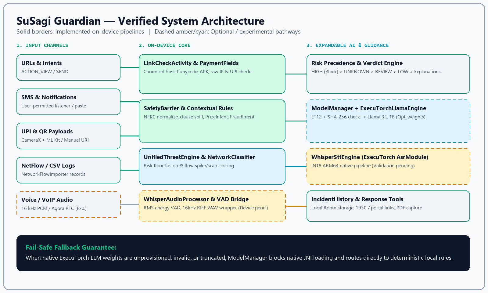

# System Architecture

SuSagi Guardian follows a **two-layer separation of concerns** designed to fail safely on mobile hardware: fast deterministic rules always run locally without network dependencies, while optional generative language and speech inference modules activate only after asset integrity validation.

---

## 1. Input Ingestion Channels

| Channel | Implementation Component | Operating Mechanism |
| :--- | :--- | :--- |
| **External Web & Shared URLs** | `LinkCheckActivity.kt`, `AndroidManifest.xml` | Intent filters for `ACTION_VIEW` (`http`, `https`) and `ACTION_SEND` (`text/plain`) intercept tapped or shared links when selected by the user. |
| **Camera QR & Barcodes** | `QrScannerActivity.kt` | CameraX frame pipeline (`1.3.4`) paired with ML Kit (`barcode-scanning:17.2.0`) decodes `upi://pay` and web URIs locally before handoff. |
| **SMS / Notification Content** | `NotificationScannerService.kt`, `MessageScanScreen.kt` | Inspects notification text only after explicit Android Settings listener approval, plus manual paste inspection. Does not inspect encrypted chat databases. |
| **Network Flow CSV Telemetry** | `NetworkFlowImporter.kt`, `NetworkShieldScreen.kt` | Parses structured CSV/flow records (`NetworkFlowRecord`) locally on device. Does not passively sniff other applications' traffic on non-rooted Android. |
| **Voice & VoIP Audio *(Exp.)*** | `WhisperAudioProcessor.kt`, `AudioFrameBridge.kt`, `AgoraEngine.kt` | Buffers 16 kHz mono PCM samples via RMS energy VAD into RIFF WAV turns for optional Whisper analysis, or experimental Agora RTC/RTM streams. |

---

## 2. Core Inspection & Threat Engine

### `SafetyBarrier` & Contextual Scams (`com.susagi.safety`)
- **Normalization (`SafetyBarrier.kt`):** Runs Unicode NFKC normalization, lowercasing in `Locale.ROOT`, apostrophe unification, and invisible character removal (`\u200b`, `\ufeff`, `\u2060`, `\u00ad`).
- **Quoted-Warning Suppression:** Removes educational advisories (e.g., `"scammers say: ..."` and negative Hindi advisories like `"मत भेजें"`) before actionable extraction so cybersecurity advice triggers fewer false alarms.
- **Clause-Level Contextual Engines:** Splits normalized text across sentence delimiters (`[.!?;।\n]+`) and inspects current and adjacent clauses using `PrizeIntent.java`, `FraudIntent.kt`, `CredentialIntent.kt`, and `ContextualScamRules.kt`.
- **URL & Payment Rules (`SafetyBarrier.inspect` / `PaymentFields.kt`):** Enforces canonical domain/IDN ASCII checks, raw IP checks, mixed-script label checks (`0x370..0x52f`), `.apk` download tail checks, userinfo phishing (`user@host`), shortener checks, redirect parameter recursion budgets (depth `<= 3`, budget `8`), and `upi://pay` reverse-debit verification.

### `UnifiedThreatEngine` (`com.susagi.intelligence`)
- Combines deterministic `LinkCheckActivity.evaluateLinkSafety` / `SafetyBarrier` findings with optional `ExecuTorchLlamaEngine` explanations.
- Enforces invariant score floors via `UnifiedThreatEngine.withBarrier(assessment)`:
  - `Risk.HIGH` enforces score `>= 85` (`RECOMMEND_BLOCK`).
  - `Risk.UNKNOWN` maps to `DO_NOT_OPEN`.
  - `Risk.REVIEW` enforces score `>= 40` (`ASK_CONFIRMATION`).
  - `Risk.LOW` permits optional continuation (`OFFER_OPEN`) with explicit uncertainty disclosure (`"Offline inspection cannot establish ownership, reputation or the destination after navigation."`).

### `NetworkAnomalyClassifier` (`com.susagi.network`)
- Inspects `NetworkFlowRecord` entries and batches for outbound administrative port attempts (`22` SSH, `23` Telnet, `3389` RDP, `445` SMB, `135` RPC, `5555` ADB), high-rate SYN bursts (`pps > 100.0` without `ACK`), port scans, and periodic beaconing intervals (`beaconMinIntervalCount = 4`, `beaconMaxJitterRatio = 0.15f`) while exempting benign periodic ports (`53` DNS, `123` NTP, `67/68` DHCP).

---

## 3. Optional On-Device AI Modules (`com.susagi.edgeai` & `com.susagi.stt.whisper`)

- **LLM Explanations (`ExecuTorchLlamaEngine.kt`):** Uses Meta ExecuTorch `LlmModule` (`org.pytorch:executorch-android:1.5.1`) with Llama 3.2 1B Instruct templates constructed by `ThreatPromptBuilder` (`seqLen = 2048`, `echo = false`), hardened by `sanitizeLlamaOutput` and `isPromptEcho`.
- **Speech Transcription (`WhisperSttEngine.kt`):** Wraps `AsrModule` (`16 kHz` mono WAV segments, `WhisperDecoder` repetition & special-token cleanup). Physical hardware validation remains pending.
- **Knowledge & Rule Fallback:** `ConversationalKnowledgeEngine` and `executeLocalHeuristicIntelligence()` maintain full application operation when model files are not yet staged or validated.

---

## 4. Storage, Evidence & Escalation

- **Local Persistence (`Room` & `SharedPreferences`):** Call audit entries (`CallHistoryEntity.kt`), local threat logs, and user trusted-contact config persist locally on device.
- **Incident Remediation:** Generates formatted threat summaries, captures PDF evidence (`EvidenceCaptureActivity`), and links users to India's Cybercrime Helpline **1930** and `https://cybercrime.gov.in`.
