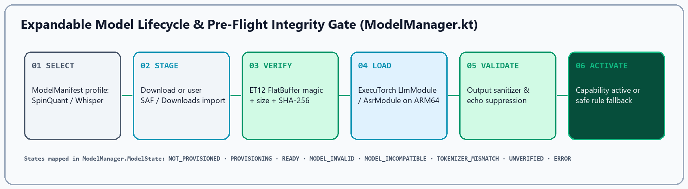

# Model Lifecycle & Provisioning Guide

**Target Runtime:** `org.pytorch:executorch-android:1.5.1` (`arm64-v8a`)  
**Source of Truth:** `ModelManifest.kt`, `ModelManager.kt`, `WhisperModelManager.kt`

SuSagi Guardian separates core deterministic security logic from optional heavyweight neural model assets. Large weight archives (`.pte`) are **not bundled in the APK or committed to this Git repository**; they are provisioned on-device at runtime or via manual user import.

---

## 1. Expandable Intelligence Lifecycle

Every edge AI asset transitions through explicit states tracked by `ModelManager.ModelState`:

1. `NOT_PROVISIONED` — No valid `.pte` model or tokenizer detected across candidate storage paths.
2. `PROVISIONING` — User-initiated transfer or download is in progress.
3. `READY` — FlatBuffer `ET12` header, size bounds, and tokenizer pairing pass pre-flight validation.
4. `MODEL_INVALID` — Corrupted header, truncated download, or missing `ET12` magic identifier.
5. `MODEL_INCOMPATIBLE` — SHA-256 digest mismatch or unsupported profile configuration.
6. `TOKENIZER_MISMATCH` — Tokenizer binary/JSON format disagrees with the active `.pte` model profile.
7. `UNVERIFIED` — File present outside pinned manifest size/profile metadata.
8. `ERROR` — I/O or native initialization error caught before unsafe JNI dispatch.

---

## 2. Verified Model Manifest Profiles (`ModelManifest.kt`)

### Language Models (`org.pytorch.executorch.extension.llm.LlmModule`)

| Profile ID | Model & Quantization | Files Required | Size Bounds | SHA-256 Verification Target |
| :--- | :--- | :--- | :--- | :--- |
| `llama_3_2_1b_spinquant` | Llama 3.2 1B Instruct (`SpinQuant Int4 XNNPACK`) | `llama_3_2_1b_xnnpack_spinquant.pte` `tokenizer.json` (HF Tiktoken) | ~1.08 GB (`1,082,483,584` B) ~9.45 MB (`9,906,781` B) | Model: `cd9b0bcc...7111ad2` Tok: `0b9897f5...f1ce0` |
| `llama_3_2_1b_community` | Llama 3.2 1B Community (`FP16 / BF16`) | `llama3_2-1B.pte` `tokenizer.model` | ~2.47 GB (`2,471,922,052` B) ~2.08 MB (`2,183,982` B) | Model: `f86e3217...3f277e7` Tok: `82e9d319...551b55` |

### Speech Recognition Models (`org.pytorch.executorch.extension.asr.AsrModule`)

| Profile ID | Model & Quantization | Required Artifacts | Approximate Size |
| :--- | :--- | :--- | :--- |
| `whisper_tiny_arm` | Whisper-Tiny (39M params, INT8 XNNPACK) | `whisper_tiny_vivo_executorch_optimized.pte` `whisper_preprocessor.pte` + `tokenizer.json` | ~116.58 MB + ~78 KB + ~2.37 MB |
| `whisper_small_arm` | Whisper-Small (244M params, INT8 XNNPACK) | `whisper_small_vivo_executorch_optimized.pte` `whisper_preprocessor.pte` + `tokenizer.json` | ~395.05 MB + ~78 KB + ~2.37 MB |

*(Exact SHA-256 digests and pinned Hugging Face commit revisions are declared in `app/src/main/java/com/susagi/edgeai/ModelManifest.kt`.)*

---

## 3. Pre-Flight Crash Prevention & Storage Discovery

To prevent native `SIGABRT` crashes caused by incomplete or truncated downloads in `libexecutorch.so`:

- `ModelManager.validateModelAsset()` reads initial file bytes to confirm the ExecuTorch FlatBuffer `ET12` identifier (`0x45 0x54 0x31 0x32` at offset `4` with bounded `rootTableOffset`, or offset `0`), verifies profile size tolerances (`±50 MB` vs expected size), and supports full SHA-256 digest verification.
- `ExecuTorchLlamaEngine` defers `LlmModule.load()` initialization until explicitly invoked or validated (`isReady`), falling back to `executeLocalHeuristicIntelligence()` whenever assets are missing or corrupt.
- **Discovery & Import:** `ModelManager.getCandidateDirectories()` checks app-private `filesDir/models`, user Downloads folders (`/sdcard/Download`, `/sdcard/Download/llama`, `/sdcard/Download/susagi`), and manual Storage Access Framework (SAF) file picker imports via the **AI Model Manager** screen.

---

## 4. Provisioning Without Polling or Bundling Weights

1. Open **AI Packs / AI Model Manager** inside SuSagi Guardian.
2. Select a target tier (deterministic core requires `0 MB`; Whisper Tiny requires ~`119 MB`; Llama 3.2 1B SpinQuant requires ~`1.09 GB` plus ~`750 MB–1.2 GB` working RAM headroom).
3. Either initiate an in-app transfer or import user-staged `.pte`, preprocessor, and tokenizer files from device storage.
4. Confirm status reads `READY` and `Tokens/Telemetry` validate on physical `arm64-v8a` hardware before relying on generative outputs.
